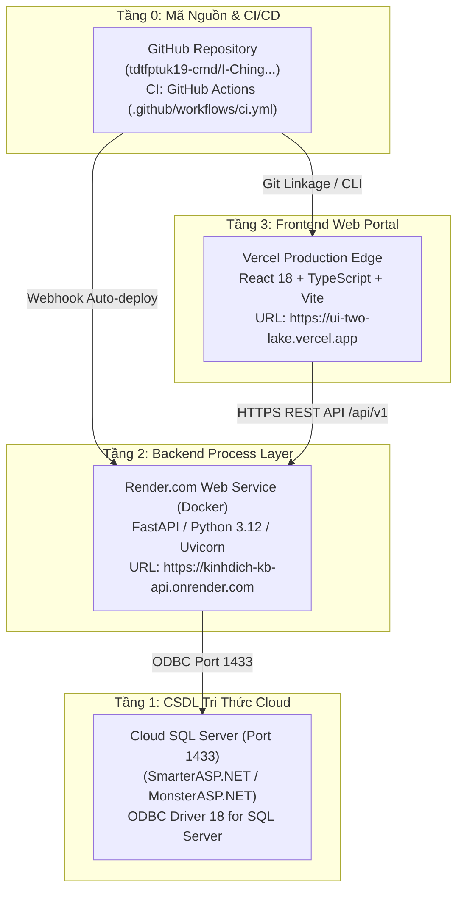

# Deploy: Quy Trình Triển Khai Toàn Diện Hệ Thống KMS301 / KinhDich_KB

Skill này đóng gói toàn bộ quy trình, công cụ và tri thức vận hành để triển khai an toàn, chuẩn xác và đồng bộ 4 tầng của dự án **Cổng Tri Thức Kinh Dịch KMS301** lên các nền tảng đám mây tương ứng.

---

## 1. Bản Đồ Nền Tảng Triển Khai (Platform Topology)

Hệ thống KMS301 được phân tách kiến trúc và triển khai độc lập trên 4 nền tảng chuyên biệt:



---

## 2. Checklist Trước Khi Triển Khai (Pre-flight Checklist)

Trước khi thực hiện đẩy code hoặc deploy lên bất kỳ nền tảng nào, thực hiện nhanh các bước kiểm tra sau:

- [ ] **Bảo vệ CSDL gốc**: Tuyệt đối không trỏ biến môi trường ghi dữ liệu thử nghiệm vào CSDL Production.
- [ ] **Mã nguồn sạch**: Đảm bảo không có xung đột git, không còn tệp rác.
- [ ] **Kiểm tra Frontend**:
  - Chạy `npm run typecheck` trong thư mục `ui/` không phát sinh lỗi kiểu dữ liệu.
  - Chạy `npm run build` trong thư mục `ui/` sinh bundle thành công vào `ui/dist`.
- [ ] **An toàn bảo mật**: Không hardcode mật khẩu, connection string hay API key bí mật vào git commit.

Kiểm tra nhanh bằng script:
```powershell
powershell -ExecutionPolicy Bypass -File "scratch/check_system_health.ps1"
```

---

## 3. Quy Trình Triển Khai Chi Tiết Từng Nền Tảng

### Bước 1: Tầng Mã Nguồn & CI/CD (GitHub)
Đẩy toàn bộ mã nguồn mới nhất lên GitHub để làm nguồn chuẩn cho Render và Vercel:

```bash
# 1. Kiểm tra trạng thái
git status

# 2. Thêm các tệp đã sửa đổi
git add .

# 3. Commit theo chuẩn Conventional Commits
git commit -m "feat(deploy): cập nhật tính năng và đồng bộ cấu hình production"

# 4. Đẩy lên nhánh chính
git push origin main
```
> [!NOTE]
> GitHub Actions sẽ tự động kích hoạt workflow `.github/workflows/ci.yml` để chạy ESLint, TypeScript Typecheck, Vitest Unit Tests và Playwright E2E Audits.

---

### Bước 2: Tầng CSDL Cloud (SmarterASP.NET / MonsterASP.NET)
*Chỉ cần thực hiện khi có thay đổi về Schema DDL, cập nhật 64 quẻ, bổ sung quy tắc suy diễn hoặc trọng số Double-Loop.*

1. **Kiểm tra thông cổng 1433**:
   ```powershell
   Test-NetConnection -ComputerName <cloud_server_host> -Port 1433
   ```
2. **Chạy script nạp tự động**:
   ```powershell
   powershell -ExecutionPolicy Bypass -File "scratch/run_cloud_sql_migration.ps1"
   ```
   Script sẽ tự động đọc các tệp SQL không BOM trong `_out\`, ánh xạ tên database được cấp phát và nạp tuần tự qua `sqlcmd`.

👉 Xem hướng dẫn chi tiết tại: [references/cloud_database_migration.md](./references/cloud_database_migration.md)

---

### Bước 3: Tầng Backend Process Layer (Render.com)
Backend được đóng gói bằng Docker (`Dockerfile` với base Debian 12 Bookworm + Microsoft ODBC Driver 18).

1. **Cơ chế triển khai tự động**:
   - Khi commit được push lên nhánh `main` của GitHub, Render sẽ tự động pull và build lại container.
2. **Triển khai thủ công (Manual Deploy)**:
   - Truy cập [Render Dashboard](https://dashboard.render.com/) -> Chọn dịch vụ `kinhdich-kb-api`.
   - Bấm **Manual Deploy** -> Chọn **Deploy latest commit** (hoặc **Clear build cache & deploy** nếu cần cài lại thư viện hệ thống).
3. **Biến môi trường bắt buộc trên Render**:
   - `DB_SERVER`: `<host_cloud>,1433`
   - `DB_NAME`: `<tên_db_cloud>`
   - `DB_USER`: `<user_db_cloud>`
   - `DB_PASSWORD`: `<password_db_cloud>`
   - `DB_DRIVER`: `ODBC Driver 18 for SQL Server`
   - `DB_TIMEOUT`: `60`
   - `ALLOW_CLIENT_PAYLOAD`: `false`

👉 Xem hướng dẫn chi tiết tại: [references/render_backend_setup.md](./references/render_backend_setup.md)

---

### Bước 4: Tầng Frontend Web UI (Vercel)
Ứng dụng giao diện đặt tại thư mục `ui/`, kết nối trực tiếp với Backend API qua biến môi trường `ui/.env.production`.

#### Cách 1: Chạy Script Tự Động (Khuyến nghị trên Windows)
Chạy file script có sẵn trong dự án:
```cmd
cd ui
deploy-vercel.bat
```
Script sẽ tự động thực hiện:
1. Nạp đúng phiên bản Node.js/NPM.
2. Chạy `npm run build` để kiểm tra biên dịch và đóng gói tối ưu.
3. Chạy `npx --yes vercel --prod --yes` để phát hành bản production lên `https://ui-two-lake.vercel.app`.

#### Cách 2: Dòng Lệnh Trực Tiếp (CLI)
```bash
cd ui
npm run build
npx vercel --prod
```

👉 Xem hướng dẫn chi tiết tại: [references/vercel_frontend_guide.md](./references/vercel_frontend_guide.md)

---

## 4. Kiểm Chuẩn Sau Triển Khai (Post-Deployment Verification)

Sau khi deploy xong cả 4 tầng, bắt buộc chạy kịch bản kiểm tra sức khỏe hệ thống toàn diện:

```powershell
powershell -ExecutionPolicy Bypass -File "scratch/check_system_health.ps1"
```

### Các tiêu chí nghiệm thu:
1. **Backend Health**: `GET /api/v1/health` trả về `{"status": "ok", "database": "connected"}`.
2. **Chi tiết quẻ**: `GET /api/v1/hexagram/1` trả về đầy đủ Thoán từ, Hào từ quẻ Càn.
3. **Tìm kiếm ngữ nghĩa**: `GET /api/v1/search?q=tiềm+long` hoạt động chính xác.
4. **Hệ thống Gieo quẻ**: `POST /api/v1/divination` tính toán thành công cả Mai Hoa số và Mai Hoa thời gian.
5. **Giao diện Vercel**: Truy cập `https://ui-two-lake.vercel.app` không bị lỗi trắng trang, các route con load mượt mà không bị lỗi 404.

👉 Xem ma trận kiểm thử chi tiết tại: [references/post_deploy_verification.md](./references/post_deploy_verification.md)

---

## 5. Xử Lý Sự Cố Thường Gặp (Troubleshooting)

| Vấn đề | Nguyên nhân | Cách khắc phục |
| :--- | :--- | :--- |
| **Render báo lỗi `HYT00 Login timeout`** | CSDL Cloud ở trạng thái ngủ (Cold Start) | Tăng biến `DB_TIMEOUT=60` trên Render Environment. |
| **Render báo lỗi `08001 SSL Provider: certificate verify failed`** | Thiếu cờ xác thực chứng chỉ máy chủ | Kiểm tra chuỗi kết nối trong `config.py` đã có `TrustServerCertificate=yes` chưa (đã được cấu hình tự động cho ODBC 18). |
| **Vercel refresh trang con bị lỗi 404** | Chưa cấu hình rewrite cho SPA | Đảm bảo file `ui/vercel.json` có rule rewrite `/(.*)` trỏ về `/index.html`. |
| **Lỗi CORS trên trình duyệt khi gọi API** | Render chưa cho phép domain Vercel | Đặt biến `CORS_ORIGINS=*` hoặc `https://ui-two-lake.vercel.app` trên Render. |
| **Vercel CLI yêu cầu đăng nhập lại** | Token xác thực hết hạn | Chạy `npx vercel login`, chọn `Continue with GitHub` trên trình duyệt rồi deploy lại. |

---

## 6. Danh Mục Tài Liệu & Script Đi Kèm

- [Hồ Sơ CSDL Cloud](./references/cloud_database_migration.md)
- [Cấu Hình Backend Render](./references/render_backend_setup.md)
- [Cấu Hình Frontend Vercel](./references/vercel_frontend_guide.md)
- [Tiêu Chuẩn Kiểm Thử Live](./references/post_deploy_verification.md)
- [Script Kiểm Tra Nhanh](./scripts/quick_check_deploy.ps1)
