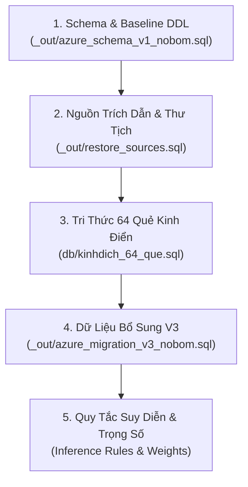

# Hướng Dẫn Di Chuyển & Nạp CSDL Cloud (SmarterASP / MonsterASP)

Tài liệu này hướng dẫn chi tiết quy trình chuẩn bị, nạp và kiểm tra CSDL quan hệ `KinhDich_KB` lên các dịch vụ lưu trữ Cloud SQL Server (MSSQL Server) từ xa.

---

## 1. Thông Tin Yêu Cầu & Tham Số Kết Nối

Khi đăng ký dịch vụ lưu trữ MSSQL trên SmarterASP.NET hoặc MonsterASP.NET, bạn sẽ nhận được các thông tin sau:

| Tham số | Ý nghĩa | Ví dụ |
| :--- | :--- | :--- |
| **Server Host** | Địa chỉ máy chủ CSDL kèm cổng 1433 | `mssql12.monsterasp.net,1433` |
| **Database Name** | Tên CSDL được cấp phát | `c301_kinhdich` |
| **Database User** | Tài khoản quản trị CSDL | `c301_kinhdich` |
| **Database Password** | Mật khẩu tài khoản CSDL | `********` |
| **ODBC Driver** | Trình điều khiển kết nối từ xa | `ODBC Driver 18 for SQL Server` |

> [!WARNING]
> Trên môi trường Cloud, các nhà cung cấp thường cấp phát tên CSDL có tiền tố cố định (ví dụ: `c1234_kinhdich`) thay vì `KinhDich_KB`. Mọi script di chuyển phải tự động điều chỉnh hoặc thay thế `USE [KinhDich_KB]` thành `USE [<tên_db_duoc_cap>]` trước khi chạy.

---

## 2. Kiểm Tra Thông Cổng Mạng (TCP Port 1433)

Trước khi thực thi nạp dữ liệu, bắt buộc kiểm tra xem mạng nội bộ và tường lửa nhà cung cấp có mở cổng 1433 hay không:

```powershell
$serverHost = "mssql12.monsterasp.net" # hoặc host của SmarterASP
$test = Test-NetConnection -ComputerName $serverHost -Port 1433
if ($test.TcpTestSucceeded) {
    Write-Host "[OK] Cổng 1433 kết nối thành công!" -ForegroundColor Green
} else {
    Write-Host "[FAIL] Không thể kết nối cổng 1433! Kiểm tra lại tường lửa hoặc địa chỉ host." -ForegroundColor Red
}
```

---

## 3. Thứ Tự Nạp Các Tệp SQL (Migration Sequence)

Để đảm bảo toàn vẹn ràng buộc khóa ngoại (Foreign Keys), các tệp SQL phải được thực thi tuần tự theo đúng thứ tự sau:



### Chi tiết các tệp:
1. `_out/azure_schema_v1_nobom.sql`:
   - Tạo cấu trúc bảng: `sources`, `trigrams`, `hexagrams`, `hexagram_lines`, `interpretations`, `inference_rules`, `five_element_relations`, `tags`, `divination_cases`.
   - Lưu ý: File đã được loại bỏ BOM (Byte Order Mark) để tương thích hoàn toàn với `sqlcmd`.
2. `_out/restore_sources.sql`:
   - Nạp toàn bộ metadata của các nguồn thư tịch (Hà Lạc Nhân Tố, Chu Dịch Bản Nghĩa, Chu Dịch Thiền Giải, v.v.).
3. `db/kinhdich_64_que.sql`:
   - Dữ liệu 64 quẻ (Thoán từ, Đại tượng, Hào từ, Tiểu tượng).
4. `_out/azure_migration_v3_nobom.sql`:
   - Nạp các bổ sung dữ liệu lớp 1 và lớp 2 theo chuẩn nghiệm thu.

---

## 4. Công Cụ Nạp Tự Động: `run_cloud_sql_migration.ps1`

Trong thư mục `scratch/`, dự án đã trang bị sẵn công cụ di chuyển tự động:

```powershell
# Chạy tương tác (sẽ hỏi Host, DB Name, User, Password một cách an toàn)
powershell -ExecutionPolicy Bypass -File "scratch/run_cloud_sql_migration.ps1"

# Hoặc truyền sẵn thông số nếu muốn:
powershell -ExecutionPolicy Bypass -File "scratch/run_cloud_sql_migration.ps1" `
    -Server "mssql12.monsterasp.net,1433" `
    -Database "cXXXX_kinhdich" `
    -AdminUser "cXXXX_kinhdich"
```

### Cơ chế hoạt động của script:
- Tự động kiểm tra kết nối TCP 1433.
- Sao chép các tệp SQL sang thư mục tạm `scratch/cloud_exec_tmp`.
- Thay thế toàn bộ mệnh đề `USE [KinhDich_KB]` thành `USE [<Database_Cloud>]`.
- Gọi `sqlcmd` với các cờ tối ưu: `-S <Server> -d <Database> -U <User> -P <Password> -b -f 65001 -I -C` (`-C` tin cậy chứng chỉ máy chủ).
- Báo cáo chi tiết từng bước nạp và cảnh báo lỗi tức thì.

---

## 5. Xác Nhận Sau Khi Nạp CSDL

Chạy câu truy vấn kiểm tra số lượng bản ghi cơ sở để xác nhận 100% dữ liệu đã lên mây:

```sql
SELECT 'hexagrams' AS TableName, COUNT(*) AS TotalRows FROM hexagrams
UNION ALL
SELECT 'hexagram_lines', COUNT(*) FROM hexagram_lines
UNION ALL
SELECT 'interpretations', COUNT(*) FROM interpretations
UNION ALL
SELECT 'inference_rules', COUNT(*) FROM inference_rules;
```

**Kỳ vọng:**
- `hexagrams`: 64
- `hexagram_lines`: 384
- `inference_rules`: Tối thiểu 10 quy tắc đã phê duyệt (Approved).
