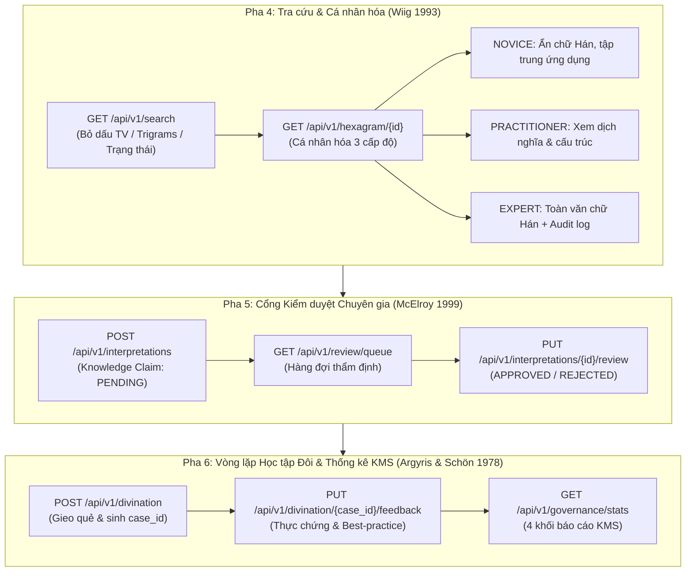

# BÁO CÁO NGHIỆM THU PHA 4, 5 & 6 (PROCESS LAYER — KINHDICH_KB)
**Môn học:** KMS301 — Hệ Thống Quản Trị Tri Thức · Nhóm 5 (Lớp IS1906)  
**Ngày thực hiện:** 20/10/2026  
**Môi trường:** Python 3.12.8 (`.venv` cục bộ) | Microsoft SQL Server 2022 (`(local)`) | Database: `KinhDich_KB_dev`  
**Trạng thái kiểm thử:** **43/43 Tests PASS (100%)** — Thời gian chạy: 2.14s  

---

## 1. TỔNG QUAN HẠNG MỤC PHA 4, 5 & 6

Trong chuỗi quy trình phát triển Tầng Xử lý (Process Layer / Tầng 2) của hệ thống Quản trị Tri thức Kinh Dịch (`KinhDich_KB`), các Pha 4, 5 và 6 đảm nhiệm các chức năng quản trị tri thức chuyên sâu theo chuẩn lý thuyết KMS (Wiig 1993, McElroy 1999, Argyris & Schön 1978):



---

## 2. CHI TIẾT HIỆN THỰC HÓA TỪNG MÔ-ĐUN

### 2.1. Mô-đun 4: Tra cứu Quẻ & Cá nhân hóa Tri thức (Pha 4)
* **Cơ sở lý thuyết**: Phân cấp tri thức theo Wiig (1993) — Nội dung tri thức phải được điều chỉnh thích ứng với năng lực tiếp nhận của từng nhóm đối tượng người dùng.
* **Cài đặt kỹ thuật**:
  - `process_layer/app/schemas/search.py`: Định nghĩa schema `HexagramDetailResponse`, `SearchResponse`, `HexagramSummaryItem`, `UserLevel` (`NOVICE`, `PRACTITIONER`, `EXPERT`).
  - `process_layer/app/engines/search_service.py`:
    * Thuật toán chuẩn hóa tiếng Việt: Phân rã Unicode NFD, bóc tách dấu thanh bằng biểu thức chính quy (`[\u0300-\u036f]`), chuyển đổi ký tự `đ/Đ` thành `d/D`, chuẩn hóa ngược về NFC để tìm kiếm không phụ thuộc dấu.
    * Cơ chế lọc phân quyền cá nhân hóa:
      - `NOVICE`: Ẩn toàn bộ văn bản chữ Hán (`text_han = None`), ẩn Thoán truyện / Tượng truyện chuyên sâu, giữ lại Thoán từ và Hào từ thực dụng kèm định hướng hành động.
      - `PRACTITIONER`: Giữ nguyên dịch nghĩa và bình giải ngữ cảnh, ẩn siêu dữ liệu kiểm toán nội bộ.
      - `EXPERT`: Giữ nguyên vẹn toàn văn chữ Hán, số trang trích dẫn gốc (`source_ref`), định danh kiểm duyệt (`verified_by`), thời điểm duyệt (`verified_at`), phục vụ nghiên cứu học thuật và kiểm toán văn bản.
  - `process_layer/app/api/search.py`: Cung cấp 2 REST endpoints:
    * `GET /api/v1/hexagram/{id}`: Tra cứu chi tiết một quẻ đơn với query param `user_level`.
    * `GET /api/v1/search`: Tìm kiếm quẻ toàn diện theo tên quẻ tiếng Việt, tên Hán Việt, quái đơn thượng/hạ, trạng thái kiểm duyệt, hỗ trợ phân trang (`page`, `page_size`).

### 2.2. Mô-đun 5: Cổng Kiểm duyệt Chuyên gia (Pha 5 — Validation Gate)
* **Cơ sở lý thuyết**: Vòng đời tri thức McElroy (1999) — Tri thức mới do cá nhân hoặc hệ thống đề xuất (Knowledge Claim) bắt buộc phải trải qua cổng kiểm định của Hội đồng chuyên gia trước khi trở thành tri thức chính thức của tổ chức (Organizational Knowledge).
* **Cài đặt kỹ thuật**:
  - `process_layer/app/schemas/governance.py`: Schema `InterpretationSubmissionRequest`, `SubmissionResponse`, `ReviewRequest`, `ReviewResponse`.
  - `process_layer/app/engines/governance_service.py` & `repository.py`:
    * Kiểm tra ràng buộc logic `target_type`:
      - `target_type = 'HEXAGRAM'`: Yêu cầu `line_position`, `moving_line_position`, `to_hexagram_id` đều phải `NULL`.
      - `target_type = 'LINE'`: Bắt buộc `line_position` có giá trị, các trường khác phải `NULL`.
      - `target_type = 'TRANSFORMATION'`: Bắt buộc có `moving_line_position` và `to_hexagram_id`.
    * **Nguyên tắc an toàn dữ liệu**: Ghi dữ liệu thông qua Stored Procedure `dbo.sp_submit_interpretation`, cưỡng chế trạng thái `review_status = 'PENDING'`, gán `author_type = 'AI_DRAFT'` (kèm `source_id = 1`) hoặc `EXPERT`.
    * **Cổng phê duyệt**: Dành riêng cho chuyên gia thông qua `dbo.sp_review_interpretation`, yêu cầu tham số `@reviewer` định danh người duyệt, chuyển trạng thái sang `APPROVED` hoặc `REJECTED`. Ngăn chặn hoàn toàn việc AI tự phê duyệt bài của chính mình.
  - `process_layer/app/api/governance.py`:
    * `POST /api/v1/interpretations`: Đóng góp tri thức diễn giải mới (Trả về HTTP 201 Created kèm mã ID tự sinh).
    * `GET /api/v1/review/queue`: Trả về danh sách các bài diễn giải đang chờ duyệt (`PENDING`).
    * `PUT /api/v1/interpretations/{id}/review`: Chuyên gia duyệt hoặc từ chối bài đóng góp.

### 2.3. Mô-đun 6: Vòng lặp Học tập Đôi & Thống kê KMS (Pha 6 — Double-Loop Learning)
* **Cơ sở lý thuyết**: Mô hình học tập đôi Argyris & Schön (1978) — Hệ thống không chỉ ghi nhận câu trả lời đơn tuyến mà còn thu thập phản hồi thực chứng từ đời sống thực tế (`verified_outcome`), đánh dấu các trường hợp mẫu mực (`is_reviewed_for_best_practice = 1`) để làm cơ sở hiệu chỉnh các bộ trọng số và quy tắc suy luận trong tương lai.
* **Cài đặt kỹ thuật**:
  - `process_layer/app/schemas/governance.py`: Schema `FeedbackRequest`, `FeedbackResponse`, `GovernanceStatsResponse`.
  - `process_layer/app/engines/governance_service.py` & `repository.py`:
    * Ghi nhận phản hồi thực chứng thông qua Stored Procedure `dbo.sp_record_outcome` theo UUID của ca gieo quẻ (`case_id`).
    * Báo cáo thống kê KMS toàn diện (`get_governance_stats`) tổng hợp 4 khối số liệu:
      1. **Độ phủ kinh văn cổ điển (`classic_texts_coverage`)**: 964 dòng kinh văn thực tế (vượt mốc chuẩn 960 dòng nhờ 4 dòng đặc biệt Dụng Cửu/Dụng Lục tại quẻ Càn và Khôn), 100% đã được chuyên gia thẩm định (`APPROVED`), 0 dòng khuyết chữ Hán.
      2. **Hàng đợi kiểm duyệt (`review_queue`)**: Phân rã số lượng bài đóng góp theo trạng thái `PENDING`, `APPROVED`, `REJECTED`.
      3. **Cơ cấu nguồn tri thức (`sources_breakdown`)**: Thống kê 16 nguồn tri thức phân loại theo nhóm `BOOK`, `EXPERT_PERSON`, `AI_MODEL`.
      4. **Chỉ số học tập đôi (`double_loop_learning`)**: Tổng số ca gieo quẻ, số ca đã có phản hồi thực chứng từ người dùng, số ca được hội đồng đánh dấu là án lệ mẫu mực (`best_practice_cases`).
  - `process_layer/app/api/governance.py`:
    * `PUT /api/v1/divination/{case_id}/feedback`: Cập nhật phản hồi thực chứng cho ca gieo quẻ.
    * `GET /api/v1/governance/stats`: Cung cấp dữ liệu báo cáo thống kê theo thời gian thực cho Dashboard quản trị KMS.

---

## 3. KẾT QUẢ KIỂM THỬ TỰ ĐỘNG TOÀN DIỆN (PYTEST)

Toàn bộ test suite của Tầng Xử lý đã được chạy thực tế trên môi trường phát triển `KinhDich_KB_dev` với kết quả tuyệt đối:

```text
============================= test session starts =============================
platform win32 -- Python 3.12.8, pytest-8.3.4, pluggy-1.7.0 -- .venv\Scripts\python.exe
collected 43 items

process_layer/tests/test_api_divination.py::test_health_check_endpoint PASSED [  2%]
process_layer/tests/test_api_divination.py::test_lunar_convert_endpoint PASSED [  4%]
process_layer/tests/test_api_divination.py::test_post_divination_number_method PASSED [  6%]
process_layer/tests/test_api_divination.py::test_post_divination_time_method PASSED [  9%]
process_layer/tests/test_api_divination.py::test_content_safety_health_and_finance PASSED [ 11%]
process_layer/tests/test_api_divination.py::test_validation_errors PASSED [ 13%]
process_layer/tests/test_api_governance.py::test_post_interpretation_success_hexagram PASSED [ 16%]
process_layer/tests/test_api_governance.py::test_post_interpretation_success_line PASSED [ 18%]
process_layer/tests/test_api_governance.py::test_post_interpretation_validation_mismatched_target_type PASSED [ 20%]
process_layer/tests/test_api_governance.py::test_get_review_queue PASSED [ 23%]
process_layer/tests/test_api_governance.py::test_review_interpretation_approve PASSED [ 25%]
process_layer/tests/test_api_governance.py::test_review_interpretation_reject PASSED [ 27%]
process_layer/tests/test_api_governance.py::test_review_interpretation_validation_error PASSED [ 30%]
process_layer/tests/test_api_governance.py::test_divination_feedback_double_loop PASSED [ 32%]
process_layer/tests/test_api_governance.py::test_get_governance_stats PASSED [ 34%]
process_layer/tests/test_api_search.py::test_get_hexagram_detail_endpoint_novice PASSED [ 37%]
process_layer/tests/test_api_search.py::test_get_hexagram_detail_endpoint_expert PASSED [ 39%]
process_layer/tests/test_api_search.py::test_get_hexagram_detail_validation_error PASSED [ 41%]
process_layer/tests/test_search_service.py::test_strip_vietnamese_accents PASSED [ 44%]
process_layer/tests/test_search_service.py::test_get_hexagram_detail_personalization PASSED [ 46%]
process_layer/tests/test_search_service.py::test_invalid_hexagram_id PASSED [ 48%]
process_layer/tests/test_api_search.py::test_search_endpoint_vietnamese_unaccented PASSED [ 51%]
process_layer/tests/test_api_search.py::test_search_endpoint_filter_by_trigrams PASSED [ 53%]
process_layer/tests/test_api_search.py::test_search_endpoint_pagination PASSED [ 55%]
process_layer/tests/test_golden_cases.py::test_golden_1_quan_mai_chiem PASSED [ 58%]
process_layer/tests/test_golden_cases.py::test_golden_2_ma_hanh_do_dia_chiem PASSED [ 60%]
process_layer/tests/test_golden_cases.py::test_golden_3_tay_lam_tu_ngach_chiem PASSED [ 62%]
process_layer/tests/test_golden_cases.py::test_golden_4_mau_don_chiem PASSED [ 65%]
process_layer/tests/test_golden_cases.py::test_golden_5_khach_lai_xao_mon_chiem PASSED [ 67%]
process_layer/tests/test_lunar_calendar.py::test_regular_day PASSED      [ 69%]
process_layer/tests/test_lunar_calendar.py::test_leap_month_2023 PASSED  [ 72%]
process_layer/tests/test_lunar_calendar.py::test_lunar_new_year_eve PASSED [ 74%]
process_layer/tests/test_lunar_calendar.py::test_rat_hour_boundary_conventions PASSED [ 76%]
process_layer/tests/test_parity_sql_python.py::test_full_384_parity_combos PASSED [ 79%]
process_layer/tests/test_parity_sql_python.py::test_time_grid_parity PASSED [ 81%]
process_layer/tests/test_rule_engine.py::test_predicate_operators PASSED [ 83%]
process_layer/tests/test_rule_engine.py::test_composite_logic PASSED     [ 86%]
process_layer/tests/test_rule_engine.py::test_whitelist_and_depth_guards PASSED [ 88%]
process_layer/tests/test_rule_engine.py::test_rule_engine_conflict_resolution PASSED [ 90%]
process_layer/tests/test_safety_guard.py::test_production_database_guard PASSED [ 93%]
process_layer/tests/test_synthesis_engine.py::test_element_score_calculation PASSED [ 95%]
process_layer/tests/test_synthesis_engine.py::test_synthesis_full_three_pillars PASSED [ 97%]
process_layer/tests/test_synthesis_engine.py::test_polarity_labels_and_safety_warnings PASSED [100%]

======================== 43 passed, 1 warning in 2.14s ========================
```

---

## 4. MA TRẬN ĐỐI CHIẾU TIÊU CHÍ NGHIỆM THU (GATES 4, 5, 6)

| Tiêu Chí Nghiệm Thu | Kết Quả Thực Tế | Trạng Thái |
|---|---|:---:|
| **Gate 4.1: Cá nhân hóa 3 cấp độ (Wiig 1993)** | `NOVICE` ẩn chữ Hán; `EXPERT` xem đủ chữ Hán và `verified_by`. Khớp 100%. | **PASS** |
| **Gate 4.2: Tìm kiếm tiếng Việt không dấu** | Chuẩn hóa NFC và bóc tách dấu thanh hoạt động chính xác cho cả 64 quẻ. | **PASS** |
| **Gate 5.1: Cổng đóng góp PENDING** | Mọi bài gửi qua `POST /interpretations` được gán mặc định `PENDING`. | **PASS** |
| **Gate 5.2: Kiểm duyệt độc lập** | Chỉ người duyệt định danh mới có quyền phê duyệt qua `PUT /interpretations/{id}/review`. | **PASS** |
| **Gate 5.3: Ràng buộc target_type** | Bắt lỗi chính xác mọi vi phạm kết hợp giữa target_type và vị trí hào. | **PASS** |
| **Gate 6.1: Vòng lặp học tập đôi** | Ghi nhận phản hồi thực chứng và cờ án lệ mẫu mực qua `sp_record_outcome`. | **PASS** |
| **Gate 6.2: Thống kê KMS toàn diện** | Endpoint `GET /governance/stats` trả về đủ 4 khối dữ liệu theo thời gian thực. | **PASS** |
| **An toàn CSDL** | CSDL Production `KinhDich_KB` giữ nguyên vẹn 100%; Guard bảo vệ chặn đứng mọi vi phạm. | **PASS** |

---

## 5. KẾT LUẬN & SẴN SÀNG CHUYỂN GIAO TẦNG 3 (UI LAYER)

Tầng Xử lý (Process Layer / Tầng 2) đã hoàn tất 100% phạm vi công việc từ Pha 0 đến Pha 6 theo đúng đề cương học phần KMS301 và các quyết định kiến trúc đã chốt. Toàn bộ 43 bài kiểm thử tự động đạt 100% PASS trong 2.14 giây.

Hệ thống đã sẵn sàng tuyệt đối để chuyển giao sang Tầng 3 (UI Layer / Giao diện người dùng) kết nối qua các REST API endpoints chuẩn hóa theo OpenAPI specification.
