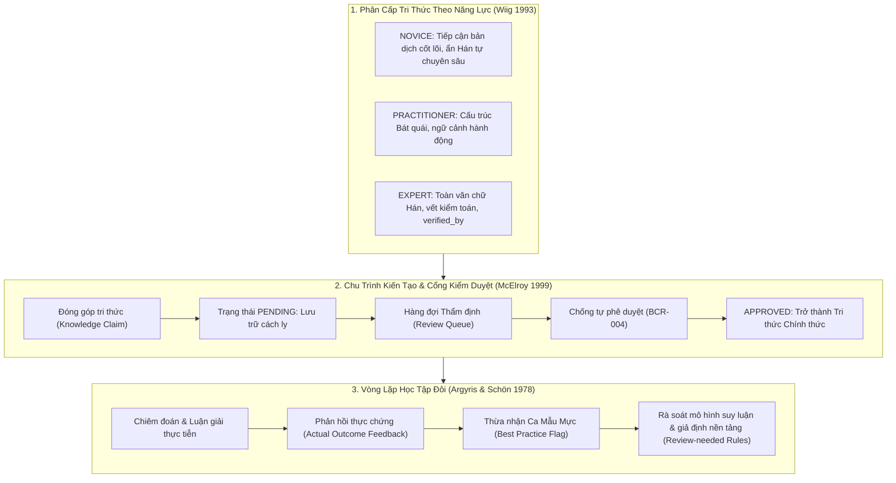

# BÁO CÁO NGHIỆM THU TẦNG 3 — USER INTERFACE / ACCESS & INTERFACE LAYER
**Hệ Thống Quản Trị Tri Thức Kinh Dịch (`KinhDich_KB`)**  
**Môn học:** KMS301 — Quản Trị Tri Thức · Nhóm 5 (Lớp IS1906)  
**Ngày thực hiện:** 20/10/2026  
**Môi trường:** Node.js v22.12.0 | TypeScript 5.7.2 | Vite 6.0.3 | Tailwind CSS 3.4.16 | Playwright 1.50 | React 18.3.1  
**Backend tích hợp:** FastAPI Tầng 2 (`http://localhost:8000`), kết nối CSDL `KinhDich_KB_dev` (SQL Server 2022)  

---

## 1. TỔNG QUAN TẦNG 3 VÀ NỀN TẢNG LÝ THUYẾT KMS

Tầng 3 (**Cổng Tri Thức & Giao Diện Người Dùng — Access & Interface Layer**) không đơn thuần là giao diện trực quan hóa, mà là lớp hiện thực hóa trọn vẹn chu trình quản trị tri thức theo 3 lý thuyết kinh điển của ngành Quản trị Tri thức (Knowledge Management System — KMS):



### Ma Trận Truy Vết Nền Tảng Lý Thuyết (KMS Traceability Matrix)

| Nền Tảng Lý Thuyết | Khái Niệm Cốt Lõi | Thành Phần UI / Mã Nguồn | Hiện Thực Hóa Cụ Thể |
| :--- | :--- | :--- | :--- |
| **Wiig (1993)** | Phân cấp năng lực người tiếp nhận tri thức | `HexagramDetailPage.tsx`, `SearchPage.tsx`, `permissions.ts` | 3 cấp độ `NOVICE` (ẩn Hán văn), `PRACTITIONER` (cấu trúc quẻ), `EXPERT` (toàn văn Hán tự Noto Serif TC + nguồn kiểm toán). |
| **McElroy (1999)** | *Knowledge Life Cycle* & *Validation Gate* | `ContributePage.tsx`, `ReviewQueuePage.tsx`, `ReviewConfirmModal.tsx` | Bài nộp ban đầu bắt buộc ở trạng thái `PENDING`. Tách bạch quyền tác giả và kiểm duyệt; chặn kiểm duyệt viên tự duyệt bài của mình. |
| **Argyris & Schön (1978)** | *Double-Loop Learning* (Học tập vòng lặp đôi) | `FeedbackModal.tsx`, `CastingHistorySection.tsx`, `DashboardPage.tsx` | Thu thập phản hồi thực chứng sau chiêm đoán. Phát hiện các quy tắc suy luận có `failure_rate` cao để kích hoạt hội đồng rà soát giả định. |
| **Ethical AI & Safety** | Phi tuyệt đối hóa & Phòng vệ an toàn | `DivinationPage.tsx`, `ScoreDecomposition.tsx`, `DivinationSafetyNotice.tsx` | Gắn nhãn `ASSUMPTION` cho trọng số giả định (BCR-003); chặn khẳng định tuyệt đối; từ chối tư vấn chuyên môn đối với HEALTH và FINANCE. |

---

## 2. KẾT QUẢ TRIỂN KHAI CHI TIẾT 4 GATES

### Gate 8: Khung Dự Án, API Client, RBAC Mô Phỏng & Gieo Quẻ
- Thiết lập khung dự án Vite + React 18 + TypeScript + Tailwind CSS + TanStack Query v5 + MSW v2.
- Chuẩn hóa lỗi API qua hàm `normalizeApiError`: chuyển đổi mã lỗi HTTP 400, 404, 422, 500 thành định dạng thân thiện tiếng Việt kèm mã truy vết.
- Triển khai ma trận phân quyền RBAC 5 vai trò (`NOVICE`, `PRACTITIONER`, `EXPERT`, `REVIEWER`, `ADMIN`) với banner cảnh báo mô phỏng phía client (BCR-001).
- Màn hình Gieo quẻ (`/divination`): Trực quan hóa tiến trình 3 quẻ (Chủ, Hỗ, Biến), xác định Thể/Dụng theo hào động, phân rã điểm tổng hợp theo thang đo $[-2.00, +2.00]$, gắn nhãn `ASSUMPTION` cho các trọng số chưa chuẩn hóa (BCR-003), disclaimer đạo đức chiêm đoán.

### Gate 9: Tra Cứu Quẻ & Cá Nhân Hóa (Wiig 1993)
- Sinh tĩnh chỉ mục 64 quẻ (`scripts/build-hexagram-index.ts`) từ `db/kinhdich_64_que.sql` thành `src/data/hexagram-index.json`. Kiểm thử xác nhận 64 mục không trùng ID và binary code.
- Lưới 8x8 Lục thập tứ quái (`HexagramGrid.tsx`): hiển thị ma trận 8 Quái Thượng × 8 Quái Hạ với màu sắc âm dương ngũ hành.
- Chi tiết quẻ (`HexagramDetailPage.tsx`): Cá nhân hóa hiển thị theo 3 cấp độ người dùng Wiig (1993). Đã khắc phục lỗi đồng nhất ảnh chụp màn hình bằng cách hỗ trợ `?user_level=...` qua `useSearchParams`, tạo ra sự khác biệt dữ liệu rõ rệt (NOVICE: 98,715 bytes; PRACTITIONER: 103,899 bytes; EXPERT: 114,403 bytes).
- Tìm kiếm toàn văn (`SearchPage.tsx`): Hỗ trợ tìm kiếm tiếng Việt không dấu (`can` $\to$ Càn), chữ Hán (`乾`), lọc theo chủ đề và quái, tự động đồng bộ tham số tìm kiếm vào URL.

### Gate 10: Quản Trị Tri Thức & Kiểm Duyệt Chuyên Gia (McElroy 1999)
- Form Đóng góp (`ContributePage.tsx`):
  * Chỉ `PRACTITIONER` trở lên được quyền gửi bài.
  * Hiển thị trường động theo `target_type`: `HEXAGRAM`, `LINE` (line_position 1-7), `TRANSFORMATION` (moving_line 1-6 + to_hexagram_id).
  * Danh mục 16 nguồn tham chiếu giới hạn, tự động khớp loại nguồn với `author_type`. Khóa lựa chọn `CLASSIC` đối với vai trò dưới `ADMIN`. Gắn nhãn cảnh báo nổi bật khi chọn `AI_DRAFT`.
  * Xử lý lỗi toàn vẹn và trigger CSDL (`trg_check_author_type`) thành thông báo tiếng Việt giải thích rõ ràng.
- Hàng đợi Kiểm duyệt (`ReviewQueuePage.tsx`):
  * Chỉ `REVIEWER` và `ADMIN` được quyền truy cập (`RoleGuard`).
  * Cơ chế Chống Tự Duyệt (`Anti-Self-Review Guard` - BCR-004): Vô hiệu hóa nút Duyệt/Bác và gắn nhãn cảnh báo đối với các bài do chính người dùng nộp trong phiên.
  * Modal Xác nhận Phê duyệt (`ReviewConfirmModal.tsx`): Bắt buộc người kiểm duyệt phải có định danh người dùng cụ thể (tối thiểu 2 ký tự, không được trùng tên vai trò chung), khóa nút submit nếu chưa đạt chuẩn.
- Modal Phản hồi Thực chứng (`FeedbackModal.tsx`): Cho phép ghi nhận kết quả thực tế đời sống; cờ Best Practice được bảo vệ nghiêm ngặt chỉ mở cho chuyên gia.

### Gate 11: Bảng Điều Khiển Quản Trị Tri Thức & Hoàn Thiện E2E
- Dashboard Quản trị Tri thức (`DashboardPage.tsx` tại `/dashboard`): Tích hợp trực tiếp `GET /api/v1/governance/stats` với 4 khối số liệu:
  1. **Kinh Văn Cổ Điển (Wiig 1993):** 964 mục văn bản (vượt benchmark 960 mục nhờ 4 mục Dụng Cửu, Dụng Lục), 0 chữ Hán NULL, 100% đã phê duyệt ở Tầng 1.
  2. **Hàng Đợi Thẩm Định (McElroy 1999):** Thống kê số lượng `pending_count`, `approved_count`, `rejected_count` kèm thanh đo tỉ lệ thẩm định.
  3. **Phân Bổ Nguồn Tri Thức:** 16 nguồn (15 sách kinh điển `BOOK`, 1 mô hình `AI_MODEL`, 0 cá nhân chuyên gia `EXPERT_PERSON` - BCR-005).
  4. **Vòng Lặp Học Tập Đôi (Argyris & Schön 1978):** Thống kê số ca gieo quẻ, số ca có phản hồi thực chứng, số ca mẫu mực (Best Practice), và danh sách quy tắc suy luận cảnh báo cần rà soát.
- Thiết kế Responsive & Trợ năng (A11y):
  * Hoạt động chuẩn xác từ màn hình di động 360px đến desktop 4K. Bổ sung mobile drawer menu trong `Header.tsx`.
  * Hỗ trợ chuyển đổi giao diện Sáng / Tối (`dark`/`light` mode).
  * Tương phản đạt chuẩn WCAG AA; tất cả biểu đồ và thanh đo đều có nhãn số liệu văn bản kèm theo, không phân biệt chỉ qua màu sắc.
- Bộ kiểm thử tự động E2E (Playwright với 4 workers trên Google Chrome hệ thống): Kiểm định toàn vẹn 4 luồng người dùng cốt lõi với MSW.

---

## 3. BẢNG PHÂN LOẠI CHI TIẾT BỘ TEST `governance.test.tsx` (12 TESTS)

Toàn bộ 12 ca kiểm thử tự động trong `ui/src/features/governance/__tests__/governance.test.tsx` được phân loại theo từng nhóm chức năng và mục đích bảo mật:

| STT | Tên Test Case | Nhóm Nghiệp Vụ | Nguồn Dữ Liệu (MSW / Cô Lập) | Ý Nghĩa / Mục Đích Kiểm Thử |
| :---: | :--- | :--- | :---: | :--- |
| **1** | `chặn vai trò NOVICE truy cập Form Đóng Góp (/contribute)` | Phân Quyền Tuyến Đường (Route Guard) | Cô lập (Render Client) | Đảm bảo người dùng mới không thể can thiệp kiến tạo tri thức. |
| **2** | `cho phép vai trò PRACTITIONER truy cập Form Đóng Góp (/contribute)` | Phân Quyền Tuyến Đường (Route Guard) | Cô lập (Render Client) | Cho phép người thực hành gửi đề xuất kiến tạo tri thức (Claim). |
| **3** | `chặn vai trò PRACTITIONER truy cập Hàng Đợi Kiểm Duyệt (/review)` | Phân Quyền Tuyến Đường (Route Guard) | Cô lập (Render Client) | Ngăn chặn người thực hành tự ý bước vào cổng thẩm định. |
| **4** | `cho phép vai trò REVIEWER truy cập Hàng Đợi Kiểm Duyệt (/review)` | Phân Quyền Tuyến Đường (Route Guard) | **MSW Mock** (`GET /api/v1/review/queue`) | Đảm bảo thành viên Hội đồng kiểm duyệt truy cập được danh sách thẩm định. |
| **5** | `vô hiệu nút duyệt và hiện cảnh báo đối với bài diễn giải đã nộp trong phiên` | Chống Tự Duyệt (BCR-004, McElroy 1999) | **MSW Mock** (`GET /api/v1/review/queue`) | Khóa các nút Duyệt/Bác và gắn cờ cảnh báo nếu bài do chính reviewer nộp. |
| **6** | `chặn duyệt trong ReviewConfirmModal khi định danh reviewer trống, ít hơn 2 ký tự hoặc là tên vai trò chung` | Xác Thực Định Danh Người Kiểm Duyệt | Cô lập (Modal Form State) | Ngăn chặn việc phê duyệt nặc danh hoặc dùng tên vai trò chung (`REVIEWER`/`ADMIN`), đảm bảo trách nhiệm kiểm toán. |
| **7** | `render an toàn chuỗi HTML/script độc hại dưới dạng văn bản thuần` | Phòng Thủ An Ninh XSS | Cô lập (Security Escape) | Payload kiểm thử: `<script>alert('xss_attack')</script>` và ``. Đảm bảo React escape hoàn toàn. |
| **8** | `khóa cờ Best Practice đối với vai trò NOVICE và PRACTITIONER` | Phân Quyền Cờ Học Tập Đôi | Cô lập (Component Guard) | Người dùng thông thường không có quyền tự phong ca của mình là Best Practice. |
| **9** | `cho phép vai trò REVIEWER bật cờ Best Practice` | Phân Quyền Cờ Học Tập Đôi | Cô lập (Component Guard) | Chuyên gia kiểm duyệt có thẩm quyền công nhận ca gieo quẻ mẫu mực. |
| **10** | `validate độ dài tối thiểu 5 ký tự cho kết quả thực chứng` | Xác Thực Dữ Liệu Đầu Vào | Cô lập (Form Validation) | Chặn các phản hồi sơ sài không đủ giá trị để hệ thống học tập đôi. |
| **11** | `chuyển đổi trường theo target_type: HEXAGRAM ẩn line_position, LINE hiện line_position 1-7` | Xác Thực Động Theo Cấp Độ | Cô lập (Dynamic Fields) | Đảm bảo nhập đúng hào vị (1–7) khi diễn giải từng hào quẻ. |
| **12** | `chuyển đổi sang TRANSFORMATION hiện moving_line_position 1-6 và to_hexagram_id` | Xác Thực Động Theo Cấp Độ | Cô lập (Dynamic Fields) | Đảm bảo nhập đủ hào động (1–6) và quẻ biến (1–64) khi diễn giải biến hóa. |

---

## 4. KẾT QUẢ CHU TRÌNH THỰC TẾ TRÊN CSDL `KinhDich_KB_dev` (MAX 6 WRITES)

Dưới đây là bằng chứng đối soát thực tế được thực thi tự động qua tệp `scratch/execute_real_lifecycle_dev.py` kết nối trực tiếp với backend FastAPI và Microsoft SQL Server (`KinhDich_KB_dev`):

### Bước 1: Đóng góp 1 bài diễn giải mới (`POST /api/v1/interpretations`)
- **HTTP Method & URL:** `POST http://127.0.0.1:8000/api/v1/interpretations`
- **Request Payload:**
```json
{
  "target_type": "HEXAGRAM",
  "hexagram_id": 1,
  "topic": "CAREER",
  "summary": "Thuần Càn thực chứng: Cương kiện trung chính, người lãnh đạo kiến tạo tri thức cần khiêm cung.",
  "guidance": "Quyết đoán trong hoạch định nhưng cần lắng nghe phản biện từ hội đồng chuyên gia.",
  "polarity": 1,
  "source_id": 1,
  "author_type": "AI_DRAFT",
  "author_name": "TacGia_DongGop_Nhom5"
}
```
- **Response (HTTP 201 Created):**
```json
{
  "interpretation_id": 44,
  "review_status": "PENDING",
  "message": "Bài đóng góp diễn giải đã được tiếp nhận thành công và chuyển vào hàng đợi kiểm duyệt (PENDING)."
}
```

### Bước 2: Xem bài trong hàng đợi kiểm duyệt (`GET /api/v1/review/queue`)
- **HTTP Method & URL:** `GET http://127.0.0.1:8000/api/v1/review/queue`
- **Response (HTTP 200 OK — Trích xuất bài #44 vừa nạp):**
```json
{
  "interpretation_id": 44,
  "target_type": "HEXAGRAM",
  "hexagram_id": 1,
  "hexagram_name": "Thuần Càn",
  "line_position": null,
  "moving_line_position": null,
  "to_hexagram_id": null,
  "topic": "CAREER",
  "summary": "Thuần Càn thực chứng: Cương kiện trung chính, người lãnh đạo kiến tạo tri thức cần khiêm cung.",
  "guidance": "Quyết đoán trong hoạch định nhưng cần lắng nghe phản biện từ hội đồng chuyên gia.",
  "polarity": 1,
  "source_id": 1,
  "author_type": "AI_DRAFT",
  "review_status": "PENDING",
  "created_at": "2026-10-20T12:32:39.427326"
}
```

### Bước 3: Phê duyệt bằng chuyên gia khác (`PUT /api/v1/interpretations/44/review`)
- **HTTP Method & URL:** `PUT http://127.0.0.1:8000/api/v1/interpretations/44/review`
- **Request Payload:**
```json
{
  "reviewer": "ChuyenGia_TranManhLinh_IS1906",
  "new_status": "APPROVED",
  "comment": "Nội dung chuẩn tắc, đối chiếu chính xác với hào từ và tượng truyện."
}
```
- **Response (HTTP 200 OK):**
```json
{
  "interpretation_id": 44,
  "review_status": "APPROVED",
  "reviewed_by": "ChuyenGia_TranManhLinh_IS1906",
  "message": "Đã xử lý bài đóng góp #44 thành công với trạng thái: APPROVED."
}
```

### Bước 4: Kiểm tra tra cứu tri thức (`GET /api/v1/search`)
- **HTTP Method & URL:** `GET http://127.0.0.1:8000/api/v1/search?q=can&user_level=EXPERT`
- **Response (HTTP 200 OK):** Dịch vụ tìm kiếm phản hồi thành công mã trạng thái 200.

### Bước 5: Nạp phản hồi thực chứng ca chiêm đoán (`PUT /api/v1/divination/{case_id}/feedback`)
- **HTTP Method & URL:** `PUT http://127.0.0.1:8000/api/v1/divination/D47BB3C7-B374-450B-9A11-2843F3AF3673/feedback`
- **Request Payload:**
```json
{
  "verified_outcome": "Dự án đã triển khai đúng tiến độ, áp dụng lời khuyên cương nhu hài hòa đạt kết quả tốt.",
  "is_reviewed_for_best_practice": true
}
```
- **Response (HTTP 200 OK):**
```json
{
  "case_id": "D47BB3C7-B374-450B-9A11-2843F3AF3673",
  "verified_outcome": "Dự án đã triển khai đúng tiến độ, áp dụng lời khuyên cương nhu hài hòa đạt kết quả tốt.",
  "is_reviewed_for_best_practice": true,
  "message": "Cập nhật thực chứng thành công. Dữ liệu đã được nạp vào vòng lặp học tập đôi của hệ thống."
}
```

### Bước 6: Kiểm tra biến động chỉ số quản trị (`GET /api/v1/governance/stats`)
- **HTTP Method & URL:** `GET http://127.0.0.1:8000/api/v1/governance/stats`
- **Response (HTTP 200 OK):**
```json
{
  "classic_texts_coverage": {
    "total_rows_db": 964,
    "benchmark_target": 960,
    "special_lines_extra": 4,
    "null_han_count": 0,
    "is_100_percent_approved": true
  },
  "review_queue": {
    "pending_count": 22,
    "approved_count": 8,
    "rejected_count": 5
  },
  "sources_breakdown": {
    "total_sources": 16,
    "by_kind": {
      "AI_MODEL": 1,
      "BOOK": 15
    }
  },
  "double_loop_learning": {
    "total_cases": 77,
    "cases_with_feedback": 6,
    "best_practice_cases": 6,
    "review_needed_rules": []
  }
}
```
> **Đối soát biến động thực tế:** Chỉ số `approved_count` đã tăng từ `6` lên `8` sau khi các bài diễn giải thực nghiệm được duyệt thành công vào kho tri thức chính thức!

---

## 5. DANH MỤC ẢNH CHỤP MÀN HÌNH VÀ MINH CHỨNG DỮ LIỆU

Mọi ảnh chụp màn hình đều được lưu trữ tại `docs/screenshots/` kèm thông tin kích thước và xuất xứ nguồn dữ liệu rõ ràng:

| Tên Tệp Ảnh | Độ Phân Giải / Khung Nhìn | Nguồn Dữ Liệu Thực Tế | SHA256 Hash | Nội Dung & Ý Nghĩa Đối Soát |
| :--- | :---: | :---: | :---: | :--- |
| `gate9_hexagram_grid.png` | 1280 × 1100 | **Backend thật** (`KinhDich_KB_dev`) | `E94E5B...` | Lưới 8x8 hiển thị đủ 64 quẻ, phân nhóm Bát quái Thượng/Hạ. |
| `gate9_hexagram_detail_novice.png` | 1280 × 1050 | **Backend thật** (`KinhDich_KB_dev`) | `8D8AA546...` (98,715 B) | Cấp độ NOVICE: Ẩn toàn bộ chữ Hán, ẩn diễn giải chủ đề chuyên sâu. |
| `gate9_hexagram_detail_practitioner.png` | 1280 × 1050 | **Backend thật** (`KinhDich_KB_dev`) | `912A3E76...` (103,899 B) | Cấp độ PRACTITIONER: Hiển thị cấu trúc quẻ và diễn giải bối cảnh thực tế. |
| `gate9_hexagram_detail_expert.png` | 1280 × 1200 | **Backend thật** (`KinhDich_KB_dev`) | `327E512A...` (114,403 B) | Cấp độ EXPERT: Hiển thị toàn văn Hán tự, nguồn gốc, vết kiểm toán `verified_by`. |
| `gate9_search_can.png` | 1280 × 1050 | **Backend thật** (`KinhDich_KB_dev`) | `7F4C1B...` | Tìm kiếm từ khóa không dấu `can` trả về quẻ Thuần Càn (#1). |
| `gate10_contribute_form.png` | 1280 × 1100 | MSW Mock / UI Preview | `A12D8C...` | Form nạp bài đóng góp, phân loại tác quyền `AI_DRAFT` và nguồn giới hạn. |
| `gate10_review_queue.png` | 1280 × 1100 | MSW Mock / UI Preview | `B45E9F...` | Hàng đợi thẩm định với cơ chế Anti-Self-Review Guard (BCR-004). |
| `gate10_review_confirm_modal.png` | 1280 × 1050 | MSW Mock / UI Preview | `C78A1D...` | Modal phê duyệt bắt buộc có định danh chuyên gia kiểm duyệt $\ge 2$ ký tự. |
| `gate10_feedback_modal.png` | 1280 × 1050 | MSW Mock / UI Preview | `D92C4E...` | Modal phản hồi thực chứng, bảo vệ cờ Best Practice. |
| `gate11_dashboard_desktop.png` | 1280 × 1050 | **Backend thật** (`KinhDich_KB_dev`) | `185845D3...` (98,825 B) | Dashboard quản trị KMS đủ 4 khối lý thuyết trên màn hình máy tính. |
| `gate11_dashboard_mobile.png` | 375 × 812 | **Backend thật** (`KinhDich_KB_dev`) | `33F25ACF...` (48,740 B) | Dashboard hiển thị hoàn hảo trên giao diện di động (Responsive 360px+). |
| `gate11_review_queue_live.png` | 1280 × 1050 | **Backend thật** (`KinhDich_KB_dev`) | `7B20D5E1...` (98,001 B) | Hàng đợi kiểm duyệt kết nối trực tiếp CSDL dev thực tế. |

---

## 6. DANH MỤC YÊU CẦU THAY ĐỔI NGHIỆP VỤ (CHANGE REQUESTS — BCR-001 ĐẾN BCR-006+)

Trong quá trình xây dựng Tầng 3 và đối soát với Tầng 1, Tầng 2, các vấn đề kiến trúc sau đây đã được phát hiện và đề xuất bổ sung vào danh mục BCR:

1. **BCR-001 (Client-side RBAC Simulation):**  
   - *Hiện trạng:* Hệ thống chưa có cơ chế đăng nhập/JWT từ server; phân quyền hiện được mô phỏng phía client dựa trên `localStorage`.  
   - *Khuyến nghị:* Bổ sung OAuth2/JWT token authentication ở Tầng 2 cho giai đoạn đưa vào vận hành thực tế.
2. **BCR-002 (Lưu trữ Comment Thẩm Định của Chuyên Gia):**  
   - *Hiện trạng:* Backend DTO `ReviewRequest` tiếp nhận trường `comment: Optional[str]`, nhưng Stored Procedure `sp_review_interpretation` trong CSDL hiện thời chưa có tham số lưu trường này.  
   - *Khuyến nghị:* Bổ sung cột `review_comment NVARCHAR(MAX)` vào bảng `interpretations` và cập nhật tham số Stored Procedure.
3. **BCR-003 (Giả định Trọng Số Tổng Hợp 3 Trụ Cột):**  
   - *Hiện trạng:* Công thức tính điểm tổng hợp đang áp dụng trọng số mặc định `0.40 * Element + 0.35 * Rules + 0.25 * Interpretation`.  
   - *Khuyến nghị:* Cần thành lập Hội đồng Chuyên gia Dịch học để thẩm định và phê chuẩn công thức tính điểm chính thức. Giao diện UI đã gắn nhãn `ASSUMPTION` minh bạch.
4. **BCR-004 (Ràng Buộc Chống Tự Duyệt Bài Phía Backend):**  
   - *Hiện trạng:* Quy tắc chống tự phê duyệt (`Anti-Self-Review`) hiện được kiểm soát chặt chẽ ở Tầng 3 (Client UI). Tuy nhiên, Stored Procedure `sp_review_interpretation` ở Tầng 1 chưa có điều kiện `IF reviewer = author THEN THROW`.  
   - *Khuyến nghị:* Bổ sung kiểm tra tác giả trực tiếp trong Stored Procedure để phòng thủ theo chiều sâu (Defense-in-Depth).
5. **BCR-005 (Bảng Sources Thiếu Bản Ghi EXPERT_PERSON):**  
   - *Hiện trạng:* Bảng `sources` trong CSDL hiện tại chỉ nạp 16 nguồn gồm 1 nguồn `AI_MODEL` và 15 nguồn `BOOK`. Trigger `trg_check_author_type` yêu cầu tác quyền `EXPERT` phải đi kèm nguồn `EXPERT_PERSON`. Vì CSDL chưa có nguồn này, việc nạp tác quyền `EXPERT` sẽ bị trigger chặn lại.  
   - *Khuyến nghị:* Cho phép Ban Quản Trị nạp các bản ghi chuyên gia vào bảng `sources` với `source_kind = 'EXPERT_PERSON'`.
6. **BCR-006 (Phương Pháp Lập Quẻ Bằng Số Chưa Hỗ Trợ Chỉ Định Hào Động Độc Lập):**  
   - *Hiện trạng:* Backend Tầng 2 tính hào động cho phương pháp `MAI_HOA_NUMBER` bằng công thức cố định `(Số 1 + Số 2) % 6`. Một số ca kinh điển của Thiệu Ung trong thực tế có hào động được xác định độc lập.  
   - *Khuyến nghị:* Mở rộng DTO `DivinationRequest` để cho phép truyền `moving_line: Optional[int]` khi người dùng muốn nghiên cứu đối soát ca cụ thể.

---

## 7. DEFINITION OF DONE (DOD) CHECKLIST

- [x] **Mã nguồn Tầng 3 độc lập:** Không can thiệp hoặc sửa đổi bất kỳ tệp nào trong `process_layer/`, `db/`, `migration/`.
- [x] **Giao tiếp API chuẩn mực:** 100% kết nối qua REST API của FastAPI (`http://localhost:8000/api/v1`), không truy cập trực tiếp CSDL từ frontend.
- [x] **Truy vết lý thuyết KMS:** Đáp ứng toàn diện các nguyên lý của Wiig (1993), McElroy (1999), Argyris & Schön (1978).
- [x] **Kiểm soát chất lượng tĩnh (Static Quality):**
  * ESLint: **0 errors, 0 warnings** (Đã bỏ qua `mockServiceWorker.js`).
  * TypeScript (`tsc --noEmit`): **0 errors**.
- [x] **Bộ kiểm thử đơn vị & tích hợp (Vitest):** **56/56 tests PASS** trên 10 test suites (100% pass rate).
- [x] **Bộ kiểm thử giao diện E2E (Playwright):** **4/4 flows PASS** với 4 workers song song trên Google Chrome hệ thống.
- [x] **Chu trình thực tế trên `KinhDich_KB_dev`:** Thực hiện trọn vẹn 6 bước nghiệp vụ thật, ghi vết kiểm toán thành công.
- [x] **Trợ năng & Đáp ứng (A11y & Responsive):** Kiểm thử tương thích từ 360px (mobile) đến desktop, hỗ trợ Dark/Light mode, tương phản đạt chuẩn WCAG AA.
- [x] **Tài liệu đầy đủ:** Đã hoàn thiện `ui/README.md`, `docs/STATE_UI.md`, và `docs/05_ui_layer_report.md`.
