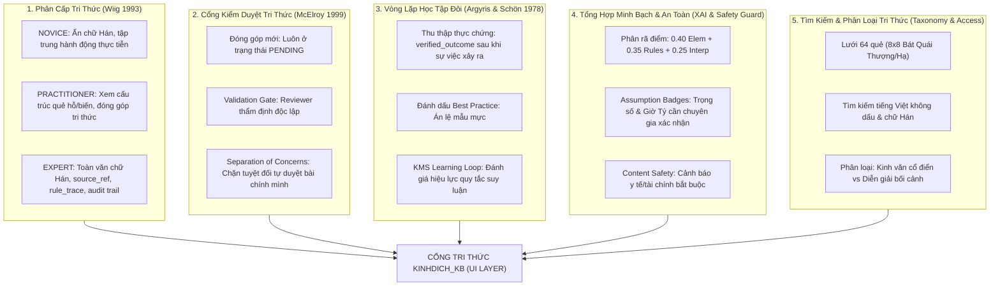

# ADR-006: Kiến Trúc Tầng Giao Diện Người Dùng & Cổng Tri Thức (UI / Access & Interface Layer)
**Dự án:** KinhDich_KB (KMS301 — Quản Trị Tri Thức · Nhóm 5, Lớp IS1906)  
**Tác giả:** Senior Frontend Engineer & KMS Solution Architect  
**Ngày lập:** 20/10/2026  
**Trạng thái:** ACCEPTED (Đã được Người dùng & Hội đồng thẩm định phê duyệt)  

---

## 1. Ngữ Cảnh & Cơ Sở Lý Thuyết Quản Trị Tri Thức (KMS Foundation)

Theo mô hình kiến trúc 3 tầng của hệ thống Quản trị Tri thức (Knowledge Management System - KMS):
- **Tầng 1 (Data Layer)**: Lưu trữ tri thức nguyên bản, cấu trúc bảng quan hệ, chuẩn hóa văn bản kinh điển và lưu vết kiểm toán (SQL Server 2022).
- **Tầng 2 (Process Layer)**: Động cơ suy luận, lập quẻ Mai Hoa, đánh giá ngũ hành, thực thi luật AST DSL an toàn, tổng hợp điểm số và điều phối cổng kiểm duyệt (FastAPI).
- **Tầng 3 (UI / Access & Interface Layer)**: **Cổng Tri thức (Knowledge Portal)** — Hiện thực hóa việc **tìm kiếm – truy cập – ứng dụng – kiểm định – học tập** tri thức cho người dùng cuối và hội đồng chuyên gia.

Giao diện người dùng không đơn thuần là "màn hình hiển thị", mà phản ánh trực tiếp 5 nền tảng lý thuyết KMS cốt lõi:



---

## 2. Quyết Định Công Nghệ (Technology Stack)

| Thành phần | Công nghệ lựa chọn | Lý do kiến trúc & Nghiệp vụ KMS |
|---|---|---|
| **Core Framework** | **React 18 + TypeScript + Vite** | SPA hiệu năng cao, type safety chặt chẽ, Developer Experience tối ưu, cấu hình build nhanh. |
| **Styling & Design System** | **Tailwind CSS** | Thiết kế linh hoạt, responsive đa thiết bị (≥ 360px), hỗ trợ Dark/Light mode, hệ màu văn hóa Á Đông trang nhã (Amber/Slate/Emerald/Rose). |
| **Server State & Caching** | **TanStack Query (React Query) v5** | Quản lý cache API, tự động refetch, phân tách loading/error state, quản lý cache invalidation sau khi review/feedback. |
| **Routing & RBAC Guard** | **React Router v6** | Điều hướng client-side, Route Guard bảo vệ theo quyền mô phỏng, đồng bộ query params cho bộ lọc tìm kiếm. |
| **Data Visualization** | **Recharts** | Trực quan hóa 4 khối thống kê KMS trên Dashboard (Donut chart nguồn, Bar chart tiến độ, Progress bar độ phủ). |
| **Icons** | **Lucide React** | Bộ icon hiện đại, tối giản, ngữ nghĩa cao. |
| **Schema Validation ở biên** | **Zod** | Xác thực kiểu dữ liệu runtime của response API, đồng bộ type TypeScript với Pydantic schema của Tầng 2. |
| **Unit & Component Testing** | **Vitest + React Testing Library** | Kiểm thử logic xử lý điểm, chuẩn hóa lỗi, route guard và các tương tác UI cốt lõi. |
| **End-to-End Testing** | **Playwright** | Kiểm thử tự động 4 luồng nghiệp vụ chính xuyên suốt từ gieo quẻ đến kiểm duyệt. |
| **API Mocking** | **MSW (Mock Service Worker)** | Mock 10 endpoint độc lập khi chạy test/offline dựa trên 13 bộ fixtures thật lưu từ `KinhDich_KB_dev`. |
| **Typography Hán Nôm** | **Noto Serif TC / SC + Source Han Serif** | Hiển thị chính xác các ký tự Hán Nôm cổ bản kinh văn mà không bị lỗi ô vuông (tofu). |

---

## 3. Cấu Trúc Thư Mục Dự Án (`ui/`)

```text
ui/
├── e2e/                                # Kịch bản kiểm thử E2E (Playwright)
│   ├── divination-flow.spec.ts         # Luồng: Gieo quẻ -> Xem kết quả -> Gửi thực chứng
│   ├── search-flow.spec.ts             # Luồng: Lưới 64 quẻ -> Chi tiết -> Tìm kiếm
│   ├── governance-flow.spec.ts         # Luồng: Đóng góp -> Hàng đợi -> Duyệt -> Công khai
│   └── dashboard-flow.spec.ts          # Luồng: Dashboard 4 khối KMS
├── public/                             # Tài nguyên tĩnh, favicon, fonts
├── scripts/
│   └── build-hexagram-index.ts         # Sinh hexagram-index.json từ SQL Tầng 1
├── src/
│   ├── api/                            # Tầng kết nối REST API (10 endpoint)
│   │   ├── client.ts                   # Axios / Fetch client cấu hình VITE_API_BASE_URL
│   │   ├── error-normalizer.ts         # Lớp chuẩn hóa lỗi đồng nhất (xử lý 4 dạng lỗi)
│   │   ├── divination.api.ts           # POST /divination, GET /lunar/convert
│   │   ├── hexagram.api.ts             # GET /hexagram/{id}
│   │   ├── search.api.ts               # GET /search
│   │   ├── governance.api.ts           # POST /interpretations, GET /review/queue, PUT review, PUT feedback, GET stats
│   │   └── health.api.ts               # GET /health
│   ├── auth/                           # RBAC mô phỏng client-side (Wiig 1993)
│   │   ├── AuthContext.tsx             # Context lưu vai trò (NOVICE/PRACTITIONER/EXPERT/REVIEWER/ADMIN)
│   │   ├── permissions.ts              # Ma trận quyền & logic canReview, canSubmit...
│   │   ├── RoleSelector.tsx            # Dropdown chuyển đổi vai trò nhanh trên Header
│   │   ├── RoleGuard.tsx               # HOC chặn route kèm trang 403 thân thiện
│   │   └── SimulatedNotice.tsx         # Banner "RBAC mô phỏng phía client — chưa có xác thực server"
│   ├── components/                     # UI components dùng chung
│   │   ├── common/                     # Button, Input, Select, Modal, Toast, Badge, Tabs
│   │   ├── layout/                     # Header, Navigation, Footer, Container
│   │   ├── HealthIndicator.tsx         # Badge kiểm tra health & cảnh báo đỏ nếu trỏ Prod
│   │   └── ErrorBoundary.tsx           # Bắt lỗi sập React UI
│   ├── features/                       # 5 thành phần nghiệp vụ theo chuẩn KMS301
│   │   ├── divination/                 # Thành phần 7.2: Gieo quẻ & Luận giải
│   │   │   ├── DivinationForm.tsx      # Form gieo: Tabs Thời gian (lunar preview) & Hai số
│   │   │   ├── DivinationResult.tsx    # Quẻ chủ/hỗ/biến, Thể Dụng, Ngũ hành, Luật kích hoạt
│   │   │   ├── ScoreDecomposition.tsx  # Phân rã điểm 3 trụ cột + tooltip Assumption
│   │   │   └── ContentSafetyAlert.tsx  # Khối cảnh báo y tế/tài chính cố định (không cho ẩn)
│   │   ├── hexagrams/                  # Thành phần 7.2 & 7.5: Tra cứu 64 quẻ
│   │   │   ├── HexagramGrid.tsx        # Lưới 8x8 Bát Quái Thượng/Hạ
│   │   │   ├── HexagramCard.tsx        # Thẻ quẻ đơn gọn
│   │   │   └── HexagramDetailView.tsx  # Trang chi tiết quẻ: Thoán/Tượng/Hào/Diễn giải
│   │   ├── search/                     # Thành phần 7.5: Tìm kiếm thông minh
│   │   │   ├── SearchBar.tsx           # Thanh search debounce, bỏ dấu tiếng Việt/Hán văn
│   │   │   ├── SearchFilters.tsx       # Bộ lọc Thượng/Hạ quái, Chủ đề, Cấp độ
│   │   │   └── SearchResultsList.tsx   # Danh sách phân trang, highlight keyword, provenance
│   │   ├── review/                     # Thành phần 7.3: Cổng Kiểm duyệt Chuyên gia
│   │   │   ├── ContributionForm.tsx    # Form đóng góp tri thức PENDING (dynamic target_type)
│   │   │   ├── ReviewQueueTable.tsx    # Bảng hàng đợi PENDING, lọc/sắp xếp, chi tiết modal
│   │   │   ├── ReviewActionModal.tsx   # Hộp thoại Duyệt/Từ chối + Nhận xét + Anti-self-review
│   │   │   └── MyContributions.tsx     # Danh sách bài đóng góp của phiên hiện tại (localStorage)
│   │   ├── feedback/                   # Thành phần 7.4: Vòng lặp Học tập Đôi
│   │   │   ├── OutcomeFeedbackForm.tsx # Form gửi verified_outcome + cờ best_practice
│   │   │   └── DivinationHistory.tsx   # Lịch sử ca gieo cục bộ (localStorage)
│   │   └── dashboard/                  # Thành phần 7.6: Báo cáo Quản trị KMS
│   │       ├── GovernanceDashboard.tsx # 4 khối số liệu: Coverage, Queue, Sources, Double-Loop
│   │       ├── ClassicCoverageCard.tsx # Khối 964 dòng kinh văn 100% approved
│   │       ├── ReviewQueueCard.tsx     # Khối hàng đợi kiểm duyệt
│   │       ├── SourcesBreakdownCard.tsx# Khối 16 nguồn tri thức
│   │       └── DoubleLoopCard.tsx      # Khối học tập đôi & cảnh báo luật nghi vấn
│   ├── i18n/                           # Nhãn tiếng Việt cho enum và thuật ngữ Kinh Dịch
│   │   ├── topics.ts                   # CAREER, RELATIONSHIP, FINANCE, HEALTH, ACADEMIC, GENERAL
│   │   ├── roles.ts                    # NOVICE, PRACTITIONER, EXPERT, REVIEWER, ADMIN
│   │   ├── polarity.ts                 # ĐẠI CÁT, TIỂU CÁT, BÌNH HÒA, TIỂU HUNG, ĐẠI HUNG
│   │   └── trigrams.ts                 # 8 quẻ đơn, tượng tự nhiên, ngũ hành, phương vị
│   ├── mocks/                          # Mocking Service Worker & Fixtures thật
│   │   ├── fixtures/                   # 13 JSON responses thật xuất từ CSDL KinhDich_KB_dev
│   │   ├── handlers.ts                 # MSW API handlers cho 10 endpoints
│   │   └── browser.ts                  # Khởi tạo MSW browser worker khi VITE_MOCK=true
│   ├── types/                          # TypeScript definitions & Zod schemas đối soát từ fixture
│   │   ├── divination.types.ts
│   │   ├── hexagram.types.ts
│   │   ├── governance.types.ts
│   │   └── common.types.ts
│   ├── App.tsx                         # Khung ứng dụng & Router
│   ├── main.tsx                        # Entry point
│   └── index.css                       # Tailwind directives & Hán Nôm font setup
├── .env.example                        # VITE_API_BASE_URL, VITE_MOCK
├── package.json
├── tailwind.config.js
├── tsconfig.json
└── vite.config.ts
```

---

## 4. Xử Lý Chi Tiết 10 Điểm Lệch Kỹ Thuật (Phát Hiện Từ Mã Nguồn Thực Tế)

Dưới đây là phương án xử lý triệt để của Tầng 3 đối với 10 điểm kỹ thuật đã nêu tại Mục 5 của Prompt:

### 4.1. Server Chưa Có Xác Thực (RBAC Client-Side Mô Phỏng)
- **Thực tế backend**: `core/security.py` chứa các hàm logic kiểm tra quyền (`can_review_submissions`...), nhưng các API router không áp dụng middleware/dependency xác thực JWT hay session.
- **Giải pháp UI**:
  - Triển khai `AuthContext` lưu vai trò người dùng trong `localStorage` (`selected_role`: `NOVICE` / `PRACTITIONER` / `EXPERT` / `REVIEWER` / `ADMIN`), mặc định `PRACTITIONER` (hoặc `NOVICE` cho người mới).
  - Cho phép người dùng chuyển nhanh vai trò qua dropdown trên Header để kiểm thử nghiệm thu.
  - Sử dụng `RoleGuard` để ẩn/khóa các route `/review`, `/dashboard` đối với các vai trò không đủ quyền.
  - Luôn hiển thị thông báo cố định: **"Hệ thống đang chạy chế độ RBAC mô phỏng phía Client — Chưa áp dụng xác thực phía Server"** nhằm bảo đảm tính trung thực tuyệt đối trong báo cáo đồ án.
  - Đề xuất thay đổi backend: **BCR-001**.

### 4.2. Tham Số `comment` Chưa Được Lưu Khi Review
- **Thực tế backend**: Schema `ReviewRequest` có trường `comment: Optional[str]`, nhưng `GovernanceService.review_interpretation` và Stored Procedure `dbo.sp_review_interpretation` hiện chưa lưu trường này xuống database.
- **Giải pháp UI**:
  - UI trong modal duyệt vẫn cung cấp ô nhập nhận xét và truyền `comment` trong payload `PUT /interpretations/{id}/review`.
  - Hiển thị tooltip hoặc chú thích ghi rõ: *"Nhận xét đang được gửi lên API; Tầng 2 đang chờ cập nhật SP để lưu trữ vĩnh viễn (xem BCR-002)"*.
  - Đề xuất thay đổi backend: **BCR-002**.

### 4.3. Không Có Endpoint Liệt Kê 64 Quẻ Cho Lưới Tra Cứu
- **Thực tế backend**: Chỉ có endpoint chi tiết `GET /api/v1/hexagram/{id}` cho từng quẻ (1..64), không có endpoint danh mục tổng quát.
- **Giải pháp UI**:
  - Viết script `ui/scripts/build-hexagram-index.ts` trích xuất danh mục 64 quẻ (id, name_vn, name_han, binary_code, upper_trigram, lower_trigram) trực tiếp từ mã nguồn Tầng 1 (`db/kinhdich_64_que.sql`) sinh ra file `hexagram-index.json`.
  - Không gõ tay dữ liệu; lưới 8x8 hiển thị tức thì từ `hexagram-index.json`. Khi người dùng click vào một ô quẻ mới gọi `GET /api/v1/hexagram/{id}` để tải toàn bộ kinh văn và diễn giải.
  - Đề xuất thay đổi backend: **BCR-003**.

### 4.4. Hàng Đợi Review Thiếu `author_name`, Đang SELECT Trực Tiếp & Ngăn Chặn Tự Duyệt (McElroy 1999)
- **Thực tế backend**:
  - `repository.DivinationRepository.get_review_queue()` hiện đang thực hiện câu lệnh `SELECT` trực tiếp trên bảng `dbo.interpretations` (chưa tuân thủ nguyên tắc View-Only của Tầng 1 & 2 vốn yêu cầu đọc dữ liệu qua SQL Views `v_*`).
  - Kết quả trả về chỉ có `author_type` (`AI_DRAFT`), hoàn toàn khuyết trường `author_name` (dù khi đóng góp có trường `author_name`). Do đó backend không thể đối soát ràng buộc `reviewer != author`.
- **Giải pháp UI**:
  - UI lưu trữ danh sách `my_submitted_interpretation_ids` vào `localStorage` cho mỗi phiên làm việc khi người dùng gửi đóng góp qua `POST /interpretations`.
  - Tại bảng Review Queue, nếu chuyên gia (Reviewer) đăng nhập và cố gắng duyệt bài có ID nằm trong `my_submitted_interpretation_ids`, UI sẽ:
    1. Vô hiệu hóa nút "Phê duyệt" / "Từ chối".
    2. Hiển thị cảnh báo: *"Nguyên tắc McElroy (1999) & ADR-005: Bạn là tác giả của bài đóng góp này. Không được phép tự phê duyệt tri thức của chính mình."*
  - Đề xuất thay đổi backend: **BCR-004** (Tạo View `v_review_queue` chứa `author_name` và chuyển `repository.get_review_queue` sang đọc qua View này).

### 4.5. Không Có Endpoint Liệt Kê Ca Gieo Quẻ / Án Lệ Mẫu Mực
- **Thực tế backend**: Chỉ trả về `case_id` (UUID) khi `POST /divination`, không có endpoint `GET /divination/cases`.
- **Giải pháp UI**:
  - Quản lý `divination_history` tại `localStorage`: lưu vết `case_id`, `created_at`, `topic`, `initial_hexagram_name`, `transformed_hexagram_name`, `score`, `polarity_label`, `verified_outcome`.
  - Màn hình "Lịch sử Ca gieo & Thực chứng": Người dùng có thể quay lại bất kỳ ca nào đã gieo để gửi phản hồi thực tế (`PUT /divination/{case_id}/feedback`) hoặc đánh dấu án lệ mẫu mực.
  - Thư viện "Best Practices": Hiển thị số lượng tổng từ `governance/stats.double_loop_learning.best_practice_cases` kết hợp danh sách án lệ đã đánh dấu trong lịch sử cục bộ.
  - Đề xuất thay đổi backend: **BCR-005**.

### 4.6. Chuẩn Hóa Lỗi Thống Nhất (`ErrorNormalizer`)
- **Thực tế backend**: Có 4 dạng lỗi phản hồi:
  1. `AppError`: `{ "code": "...", "message": "...", "details": {...} }` (status 400, 403, 404, 422, 500).
  2. `HTTPException` từ `search.py`: `{ "detail": { "code": "...", "message": "..." } }`.
  3. Lỗi validation Pydantic chuẩn: `{ "detail": [ { "loc": [...], "msg": "...", "type": "..." } ] }`.
  4. Lỗi 500 Generic: `{ "code": "INTERNAL_SERVER_ERROR", "message": "...", "details": { "error_type": "...", "error_detail": "..." } }`.
- **Giải pháp UI**:
  - Xây dựng lớp chuẩn hóa `normalizeApiError(error)` chuyển mọi dạng trên về một cấu trúc duy nhất:
    ```typescript
    interface NormalizedError {
      code: string;
      message: string;
      fieldErrors?: Record<string, string>;
      rawDetails?: unknown;
    }
    ```
  - **Nguyên tắc an toàn**: Không hiển thị `error_detail` hay Python stack trace cho người dùng thông thường; chỉ hiển thị thông điệp tiếng Việt lịch sự, dễ hiểu. Chi tiết kỹ thuật chỉ ghi ra console hoặc ẩn dưới accordion "Chi tiết kỹ thuật" cho vai trò ADMIN.
  - Đề xuất thay đổi backend: **BCR-006**.

### 4.7. Đồng Bộ URL OpenAPI & Swagger
- **Thực tế backend**:
  - Swagger UI: `http://localhost:8000/api/v1/docs` (handoff ghi nhầm `/docs`).
  - OpenAPI JSON: `http://localhost:8000/api/v1/openapi.json`.
  - Endpoint `/review/queue` có trong mã nguồn thực tế nhưng file tĩnh `docs/openapi_process_layer.json` còn thiếu.
- **Giải pháp UI**:
  - Cấu hình biến môi trường chuẩn: `VITE_API_BASE_URL=http://localhost:8000/api/v1`.
  - Thêm nút liên kết trực tiếp trên Header: "Swagger Docs" trỏ tới `http://localhost:8000/api/v1/docs` để người dùng và giảng viên đối chiếu.

### 4.8. Khác Biệt Vị Trí `user_level` & Ràng Buộc Dữ Liệu Form
- **Thực tế backend**:
  - `user_level`: Nằm trong JSON body ở `POST /divination`, nhưng là query parameter ở `GET /hexagram/{id}` và `GET /search`.
  - `MAI_HOA_NUMBER`: Yêu cầu `number_upper >= 1` và `number_lower >= 1`.
  - `MAI_HOA_TIME`: Yêu cầu `solar_datetime` định dạng ISO 8601 kèm múi giờ.
- **Giải pháp UI**:
  - Tự động đồng bộ `user_level` từ vai trò hiện tại (`AuthContext`): vai trò `NOVICE` -> gửi `user_level=NOVICE`; vai trò `PRACTITIONER` -> gửi `user_level=PRACTITIONER`; vai trò `EXPERT/REVIEWER/ADMIN` -> gửi `user_level=EXPERT`.
  - Form gieo quẻ validate kỹ trước khi submit bằng Zod: kiểm tra `number >= 1`, date-picker tự sinh chuỗi ISO 8601 với timezone offset cục bộ (`+07:00`).

### 4.9. Xử Lý Trạng Thái Tri Thức PENDING & Độ Phủ (Coverage)
- **Thực tế backend**: Diễn giải seed mẫu trên `KinhDich_KB_dev` đang ở trạng thái `PENDING`. Nhiều quẻ/chủ đề sẽ chưa có diễn giải đã duyệt -> Backend kích hoạt cơ chế fallback và trả `coverage: { is_complete: false, fallback_applied: true, message: "..." }`.
- **Giải pháp UI**:
  - Không tự bịa nội dung diễn giải.
  - Hiển thị badge trạng thái độ phủ: *"Đang áp dụng luận giải ngũ hành cơ bản — Diễn giải chuyên sâu theo chủ đề đang trong hàng đợi phê duyệt."*
  - Tuyệt đối không hiển thị bài viết `PENDING` trong giao diện người dùng công chúng.

### 4.10. Định Nghĩa Type & Zod Dựa Trên 100% Fixtures Thật
- **Thực tế backend**: Các trường `governance/stats`, `classic_texts[]`, `interpretations[]`, `advice_blocks[]`, `rules_fired[].trace` là `Dict[str, Any]` trong mã Python schemas.
- **Giải pháp UI**:
  - Không phỏng đoán key. Toàn bộ Zod schemas và TypeScript interfaces được xây dựng và đối soát trực tiếp từ 13 files fixture thật đã xuất tại `ui/src/mocks/fixtures/`.
  - Mọi trường dữ liệu như `classic_texts_coverage.benchmark_target: 960`, `special_lines_extra: 4`, `provenance.rule_ref`, `decomposition: { element_score, rule_score, interpretation_score }` đều có type chặt chẽ.

---

## 5. Ma Trận Phân Quyền Mô Phỏng (Simulated RBAC Matrix)

Tuân thủ chặt chẽ `core/security.py` và lý thuyết Wiig (1993):

| Chức Năng Trên Giao Diện | NOVICE | PRACTITIONER | EXPERT | REVIEWER | ADMIN | Cơ Sở Lý Thuyết & Ghi Chú |
|---|:---:|:---:|:---:|:---:|:---:|---|
| **Gieo quẻ & Xem kết quả** | ✔ | ✔ | ✔ | ✔ | ✔ | Wiig 1993: Trải nghiệm người dùng cơ bản |
| **Phân rã điểm (3 trụ cột)** | ✔ | ✔ | ✔ | ✔ | ✔ | Three-Pillar Synthesis (Minh bạch XAI) |
| **Cảnh báo Safety (Y tế/Tài chính)** | Bắt buộc | Bắt buộc | Bắt buộc | Bắt buộc | Bắt buộc | Content Safety Guard (Không thể ẩn) |
| **Xem Hán văn & Trích dẫn `source_ref`** | ✘ | ✘ | ✔ | ✔ | ✔ | Wiig 1993: Ẩn với Novice, chỉ hiện cho Expert |
| **Xem vết suy luận (`rules_fired.trace`)** | ✘ | ✘ | ✔ | ✔ | ✔ | Wiig 1993 & ADR-005: Truy vết suy luận |
| **Xem định danh kiểm duyệt (`verified_by`)** | ✘ | ✘ | ✔ | ✔ | ✔ | Data Lineage & Audit Trail |
| **Tra cứu 64 quẻ & Tìm kiếm** | ✔ | ✔ | ✔ | ✔ | ✔ | Knowledge Access & Taxonomy |
| **Gửi phản hồi thực chứng (`feedback`)** | ✔ | ✔ | ✔ | ✔ | ✔ | Argyris & Schön: Double-Loop Learning |
| **Đóng góp diễn giải mới (`POST /interp`)** | ✘ | ✔ | ✔ | ✔ | ✔ | McElroy 1999: Tiếp nhận Knowledge Claim |
| **Hàng đợi kiểm duyệt (`/review/queue`)** | ✘ | ✘ | ✘ | ✔ | ✔ | McElroy 1999: Validation Gate |
| **Phê duyệt / Từ chối diễn giải** | ✘ | ✘ | ✘ | ✔ | ✔ | Quyền thẩm định chuyên gia độc lập |
| **Gắn cờ Án lệ mẫu mực (`best_practice`)** | ✘ | ✘ | ✔ | ✔ | ✔ | Đánh dấu thực chứng chất lượng cao |
| **Dashboard Quản trị KMS (`/stats`)** | ✘ | ✘ | Xem | ✔ | ✔ | Báo cáo toàn diện 4 khối KMS |
| **Health Check & Kiểm soát Database** | Banner | Banner | Chi tiết | Chi tiết | Toàn quyền | An toàn hệ thống (Báo động đỏ nếu Prod) |

---

## 6. Sơ Đồ Điều Hướng & Wireframe Giao Diện (Navigation Flow)

## 6. Sơ Đồ Điều Hướng & Wireframe Giao Diện Theo Từng Vai Trò (Wiig 1993 & RBAC)

Khớp 100% với ma trận hàm kiểm tra quyền trong `process_layer/app/core/security.py`:
- `can_view_expert_details(role)`: `EXPERT`, `REVIEWER`, `ADMIN`
- `can_review_submissions(role)`: `REVIEWER`, `ADMIN`
- `can_submit_knowledge(role)`: `PRACTITIONER`, `EXPERT`, `REVIEWER`, `ADMIN`
- `validate_review_permission(reviewer_id, author_id, role)`: `reviewer != author`

```mermaid
flowchart TD
    User["Người dùng Cổng Tri thức"] --> Role{"Chọn Vai Trò (Simulated Role)"}
    
    Role -->|NOVICE| N["NOVICE (Người mới)"]
    Role -->|PRACTITIONER| P["PRACTITIONER (Người thực hành)"]
    Role -->|EXPERT| E["EXPERT (Chuyên gia nghiên cứu)"]
    Role -->|REVIEWER| R["REVIEWER (Hội đồng kiểm duyệt)"]
    Role -->|ADMIN| A["ADMIN (Quản trị viên hệ thống)"]

    subgraph Nav_Novice["Giao diện NOVICE"]
        N --> N1["/divination: Gieo quẻ (Thời gian / Hai số)"]
        N --> N2["/hexagrams: Lưới 64 quẻ (Ẩn Hán văn)"]
        N --> N3["/search: Tìm kiếm tiếng Việt"]
        N --> N4["/feedback: Gửi thực chứng ca gieo"]
    end

    subgraph Nav_Practitioner["Giao diện PRACTITIONER"]
        P --> N1
        P --> P1["/hexagrams: Xem quẻ hỗ & quẻ biến, dịch nghĩa"]
        P --> N3
        P --> P2["/contribute: Đóng góp tri thức mới (PENDING)"]
        P --> N4
    end

    subgraph Nav_Expert["Giao diện EXPERT"]
        E --> N1
        E --> E1["/hexagrams: Toàn văn chữ Hán + source_ref + verified_by"]
        E --> E2["/divination: Xem vết suy luận rule_trace"]
        E --> P2
        E --> E3["/feedback: Đánh dấu Best Practice"]
        E --> E4["/dashboard: Xem số liệu KMS (View-Only)"]
    end

    subgraph Nav_Reviewer["Giao diện REVIEWER"]
        R --> E1 & E2 & P2 & E3
        R --> R1["/review: Hàng đợi PENDING (Validation Gate)"]
        R --> R2["Phê duyệt / Từ chối (Anti-Self-Review Guard)"]
        R --> E4
    end

    subgraph Nav_Admin["Giao diện ADMIN"]
        A --> R1 & R2
        A --> A1["/dashboard: Toàn quyền quản trị & KPI KMS"]
        A --> A2["Giám sát Health Check & Bảo vệ CSDL"]
    end
```



### 6.1 Sơ Đồ Điều Hướng Chi Tiết Từng Vai Trò

#### 1. Vai trò NOVICE (Người mới tìm hiểu)
- **Menu điều hướng**: `[ Gieo Quẻ ]` | `[ Lưới 64 Quẻ ]` | `[ Tìm Kiếm ]` | `[ Lịch Sử Gieo Quẻ ]`.
- **Giới hạn hiển thị**:
  - Không hiển thị tab "Đóng góp tri thức" và "Kiểm duyệt".
  - Khi xem chi tiết quẻ và kết quả gieo: Ẩn toàn bộ chữ Hán (`text_han = null`), ẩn trích dẫn `source_ref` và mã luật suy luận.
  - Tập trung vào lời khuyên thực tế (`advice_blocks`), ý nghĩa tượng quẻ cơ bản và phân rã điểm minh bạch.
- **Thử truy cập `/review` hoặc `/dashboard`**: Điều hướng sang trang `403 Forbidden` thân thiện, giải thích lý do cần quyền hạn cao hơn.

#### 2. Vai trò PRACTITIONER (Người thực hành Kinh Dịch)
- **Menu điều hướng**: Thêm nút `[ Đóng Góp Tri Thức ]`.
- **Khả năng**:
  - Xem cấu trúc chi tiết Quẻ Chủ, Quẻ Hỗ, Quẻ Biến và hào từ dịch thơ.
  - Được mở form đóng góp diễn giải tri thức mới (`POST /interpretations`), tri thức luôn lưu ở trạng thái `PENDING`.
  - Gửi phản hồi thực chứng (`PUT /divination/{case_id}/feedback`) cho các ca gieo cá nhân.

#### 3. Vai trò EXPERT (Chuyên gia nghiên cứu Dịch học)
- **Menu điều hướng**: Thêm nút `[ Thống Kê KMS (Xem) ]`.
- **Khả năng**:
  - Hiển thị toàn văn chữ Hán chuẩn bản kinh văn, thông tin học thuật (`source_title`, `source_author`, `source_ref`, `confidence`, `verified_by`, `verified_at`).
  - Xem chi tiết dấu vết suy luận của Rule Engine (`rules_fired.trace`, toán tử vị từ và trọng số kích hoạt).
  - Được phép gắn cờ án lệ mẫu mực (`is_reviewed_for_best_practice = true`) khi gửi phản hồi thực chứng.

#### 4. Vai trò REVIEWER (Hội đồng kiểm duyệt tri thức — Validation Gate)
- **Menu điều hướng**: Thêm nút `[ Cổng Kiểm Duyệt ]` (có huy hiệu số lượng bài `PENDING`).
- **Khả năng**:
  - Truy cập màn hình hàng đợi kiểm duyệt `/review`.
  - Xem chi tiết từng đề xuất tri thức: đối chiếu nội dung tóm tắt, hướng dẫn hành động, điểm định hướng cát/hung, loại tác quyền (`AI_DRAFT` được đánh dấu rõ).
  - Phê duyệt (`APPROVED`) hoặc Từ chối (`REJECTED`) kèm nhận xét.
  - **Cơ chế chống tự phê duyệt (Anti-Self-Review Guard)**: Nếu bài viết do chính reviewer đóng góp trong phiên, nút phê duyệt/từ chối bị vô hiệu hóa kèm giải thích rõ.

#### 5. Vai trò ADMIN (Quản trị viên hệ thống)
- **Menu điều hướng**: Đầy đủ mọi menu + huy hiệu quản trị.
- **Khả năng**:
  - Toàn quyền trên mọi màn hình chức năng.
  - Giám sát tình trạng kết nối CSDL qua `/health`. **Nếu phát hiện CSDL là `KinhDich_KB` (Production) thì lập tức kích hoạt thanh cảnh báo đỏ toàn màn hình.**
  - Xem báo cáo toàn diện 4 khối KMS trên Dashboard.

### 6.2 Mô Tả Wireframe 5 Màn Hình Chính

#### 1. Màn hình Gieo Quẻ (`/divination` — Thành phần 7.2)
- **Cột trái (Form gieo)**:
  - Chọn chủ đề (CAREER, RELATIONSHIP, FINANCE, HEALTH, ACADEMIC, GENERAL).
  - Tabs phương pháp:
    - `Thời Gian (Mai Hoa)`: Date-time picker, Tùy chọn Giờ Tý (`NEXT_DAY` mặc định / `SAME_DAY`), Khối xem trước Âm lịch (gọi `/lunar/convert`: Can Chi năm, tháng, ngày, giờ, tiết khí).
    - `Hai Số (Mai Hoa)`: Nhập Số Thượng ($N_1 \ge 1$) và Số Hạ ($N_2 \ge 1$).
  - Nút "Khởi Chiêm Lập Quẻ".
- **Cột phải (Kết quả luận giải)**:
  - **3 Quẻ cốt lõi**: Quẻ Chủ (Initial) $\rightarrow$ Quẻ Hỗ (Nuclear) $\rightarrow$ Quẻ Biến (Transformed) với hào động đánh dấu rõ, phân định Thể/Dụng (`the_element`, `dung_element`).
  - **Khối Phân rã Điểm**: Điểm tổng $S \in [-2, +2]$, Nhãn Cát/Hung (ĐẠI CÁT, TIỂU CÁT, BÌNH HÒA, TIỂU HUNG, ĐẠI HUNG), Thanh tiến trình trực quan phân bổ 3 trụ cột ($0.40 \cdot S_{\text{elem}} + 0.35 \cdot S_{\text{rules}} + 0.25 \cdot S_{\text{interp}}$), huy hiệu "ASSUMPTION — Cần chuyên gia xác nhận".
  - **Khối Cảnh báo An toàn (Content Safety Guard)**: Đối với chủ đề `HEALTH` hoặc `FINANCE`, hiển thị banner cảnh báo y tế/tài chính nổi bật, không cho phép ẩn.
  - **Kinh văn & Diễn giải**: Cá nhân hóa theo vai trò (chữ Hán chỉ hiện cho EXPERT+).
  - **Nút "Gửi phản hồi thực chứng"**: Mở modal nhập kết quả thực tế (Double-loop).

#### 2. Màn hình Tra Cứu Lưới 64 Quẻ (`/hexagrams` — Thành phần 7.2)
- Ma trận 8×8: Trục tung là Quái Thượng (Càn, Đoài, Ly, Chấn, Tốn, Khảm, Cấn, Khôn), trục hoành là Quái Hạ.
- Mỗi ô hiển thị: ID quẻ, Tên quẻ tiếng Việt, Chữ Hán, Mã nhị phân, Biểu tượng quái.
- Nhấp vào ô $\rightarrow$ Chuyển sang trang chi tiết quẻ (`/hexagrams/:id`):
  - Tabs nội dung: Thoán Từ, Đại Tượng, Tiểu Tượng, Hào Từ (1..6).
  - Diễn giải theo 6 chủ đề (lọc theo tab).
  - Hiển thị theo `user_level`: NOVICE ẩn chữ Hán, EXPERT hiện đủ Hán văn, `source_ref` và `verified_by`.

#### 3. Màn hình Tìm Kiếm Tri Thức (`/search` — Thành phần 7.5)
- Thanh tìm kiếm toàn cục: Hỗ trợ gõ tiếng Việt có dấu, không dấu (ví dụ: "can" và "càn" trả kết quả như nhau), hoặc chữ Hán.
- Bộ lọc bên cạnh: Chủ đề, Quái Thượng, Quái Hạ, Cấp độ người dùng. Đồng bộ trạng thái bộ lọc lên URL query string.
- Danh sách kết quả: Thẻ phân biệt rõ `KINH VĂN NGUYÊN TỬ` (Classic Text) vs `DIỄN GIẢI CHUYÊN GIA` (Interpretation). Highlight từ khóa tìm kiếm, hiển thị số trang trích dẫn `source_ref`. Phân trang (Pagination) chuẩn hóa.

#### 4. Màn hình Cổng Kiểm Duyệt Tri Thức (`/review` — Thành phần 7.3)
- Dành riêng cho `REVIEWER` và `ADMIN` (Route Guard chặn vai trò khác).
- **Tab 1: Hàng đợi chờ duyệt (`PENDING`)**:
  - Bảng danh sách: Mã ID, Tên quẻ, Cấp độ (Quẻ / Hào / Biến), Chủ đề, Điểm Cát/Hung, Phân loại tác quyền (`AI_DRAFT` được gắn cờ nổi bật), Thời điểm tạo.
  - Nút xem chi tiết modal (Tóm tắt + Lời khuyên hành động).
  - Nút "Phê duyệt" (Xanh) và "Từ chối" (Đỏ): Mở modal xác nhận, nhập tên Reviewer và nhận xét thẩm định.
  - Tự động chặn nếu ID bài viết nằm trong danh sách bài do chính reviewer đóng góp trong phiên (Anti-self-review).
- **Tab 2: Đóng góp tri thức mới**:
  - Form đóng góp cho `PRACTITIONER` trở lên.
  - Chọn `target_type`: HEXAGRAM (ẩn trường hào), LINE (hiện `line_position`), TRANSFORMATION (hiện `moving_line_position` và `to_hexagram_id`). Validate chính xác theo quy tắc Tầng 2.
  - Thông báo rõ sau khi gửi: *"Bài viết đã được lưu vào hàng đợi PENDING và đang chờ Hội đồng chuyên gia thẩm định."*

#### 5. Màn hình Dashboard Quản Trị KMS (`/dashboard` — Thành phần 7.6)
- **Khối 1 (Knowledge Repository Coverage)**: Độ phủ 964 dòng kinh văn cổ điển, tỷ lệ 100% APPROVED, 0 dòng khuyết chữ Hán, 4 dòng đặc biệt (Dụng Cửu/Dụng Lục).
- **Khối 2 (Validation Gate)**: Tình trạng hàng đợi kiểm duyệt (Số bài PENDING, APPROVED, REJECTED) thể hiện qua biểu đồ cột/tiến độ.
- **Khối 3 (Knowledge Taxonomy & Sources)**: Cơ cấu 16 nguồn tri thức (Donut chart: Sách cổ điển vs Chuyên gia vs AI Model).
- **Khối 4 (Double-Loop Learning)**: Thống kê học tập đôi (Tổng số ca gieo, số ca có phản hồi thực chứng, tỷ lệ phản hồi, số ca án lệ mẫu mực, danh sách quy tắc suy luận cần xem xét lại).

---

## 7. Danh Sách Đề Xuất Thay Đổi Backend (Backend Change Requests — BCR)

Để tuân thủ **Ràng buộc bất biến số 1** ("Không sửa bất kỳ file nào trong `process_layer/`, `db/`... ghi vào danh sách BCR"), dưới đây là danh sách đề xuất gửi đội ngũ Backend:

| Mã BCR | Endpoint / Thành phần | Mức độ ưu tiên | Mô tả Vấn đề & Yêu cầu Thay đổi | Giải pháp Tạm thời của Tầng UI |
|---|---|:---:|---|---|
| **BCR-001** | Toàn bộ API routers | **Cao** | Chưa có cơ chế xác thực JWT/OAuth2 và kiểm tra quyền tại tầng server. Client có thể gọi trực tiếp endpoint nếu biết URI. Đề xuất bổ sung FastAPI security dependency (`HTTPBearer` hoặc cookie-based auth). | UI triển khai RBAC mô phỏng client-side, Route Guard, và hiển thị banner cảnh báo minh bạch. |
| **BCR-002** | `PUT /interpretations/{id}/review` | **Trung bình** | Schema có nhận `comment: Optional[str]`, nhưng `GovernanceService` và SP `sp_review_interpretation` chưa truyền/lưu comment này. Đề xuất mở rộng SP để lưu vết lý do duyệt/từ chối. | UI vẫn gửi `comment` trong payload và chú thích rõ trong báo cáo đồ án. |
| **BCR-003** | Mới: `GET /api/v1/hexagrams` | **Trung bình** | Chưa có endpoint lấy danh sách tóm tắt 64 quẻ cho lưới tra cứu. Đề xuất thêm endpoint trả về mảng 64 quẻ (id, name_vn, name_han, binary_code, upper_trigram, lower_trigram). | UI dùng script `build-hexagram-index` sinh tĩnh từ `db/kinhdich_64_que.sql`. |
| **BCR-004** | `GET /api/v1/review/queue` | **Cao** | Hàng đợi kiểm duyệt hiện tại trong mã nguồn Tầng 2 đang `SELECT` trực tiếp trên bảng `dbo.interpretations` (vi phạm nguyên tắc View-Only) và chỉ trả về `author_type`, hoàn toàn thiếu `author_name`. Server không thể kiểm tra quy tắc chống tự duyệt (reviewer ≠ author). Đề xuất: (1) Tạo SQL View `v_review_queue` chứa đầy đủ cột nghiệp vụ và `author_name`; (2) Cập nhật `DivinationRepository.get_review_queue` đọc qua View này. | UI lưu danh sách ID bài đóng góp của phiên vào `localStorage` và chặn tự duyệt ở phía client. |
| **BCR-005** | Mới: `GET /api/v1/divination/cases` | **Trung bình** | Chưa có endpoint tra cứu lịch sử ca gieo quẻ và danh sách án lệ mẫu mực (`is_reviewed_for_best_practice = 1`). Đề xuất thêm endpoint hỗ trợ lọc theo án lệ mẫu mực và phân trang. | UI lưu lịch sử ca gieo cục bộ tại `localStorage` và hiển thị tổng số từ `/governance/stats`. |
| **BCR-006** | `GET /api/v1/hexagram/{id}` & Error Format | **Thấp** | Trong `search.py`, `NotFoundError` và `ValidationError` bị bọc trong `HTTPException(detail={"code": ..., "message": ...})`, lệch cấu trúc top-level `{code, message, details}` của `AppError`. Đề xuất thống nhất một định dạng response lỗi. | UI xây dựng lớp `ErrorNormalizer` xử lý linh hoạt cả 4 định dạng lỗi. |

---

## 8. Nguyên Tắc An Toàn Dữ Liệu & Quy Định Kiểm Thử Với MSW

Căn cứ phản hồi chính thức từ Người dùng:
1. **Bảo vệ CSDL `KinhDich_KB_dev`**:
   - Tránh việc kiểm thử tự động ghi liên tục các bản ghi rác vào CSDL dev (vốn làm thay đổi số liệu kiểm toán và thống kê double-loop).
   - **Quy định bắt buộc**: Mọi kịch bản kiểm thử E2E (Playwright) và kiểm thử component (Vitest) có thao tác ghi dữ liệu (`POST /divination`, `POST /interpretations`, `PUT /review`, `PUT /feedback`) **phải chạy qua MSW (Mock Service Worker)** dựa trên 13 bộ fixtures thật đã xuất.
2. **Gọi API Thật Chỉ Ở Chế Độ Đọc (Read-Only)**:
   - Các lệnh gọi API thật chỉ áp dụng cho các thao tác đọc (`GET /health`, `GET /lunar/convert`, `GET /hexagram/{id}`, `GET /search`, `GET /review/queue`, `GET /governance/stats`) trừ khi có sự cho phép rõ ràng từ Người dùng.
3. **Cảnh Báo Môi Trường Production**:
   - Component `HealthIndicator` trên giao diện liên tục giám sát trường `database` từ `GET /api/v1/health`.
   - Nếu `database === "KinhDich_KB"`, hiển thị ngay lập tức một dải banner cảnh báo đỏ chớp nháy ở đỉnh trang: *"CẢNH BÁO: HỆ THỐNG ĐANG KẾT NỐI VÀO CSDL PRODUCTION 'KinhDich_KB'! MỌI THAO TÁC GHI ĐỀU BỊ KHÓA."*

---

## 9. Kế Hoạch Nghiệm Thu & Cổng Kiểm Soát Tiếp Theo

- **Gate 7 (Hoàn tất)**: Khảo sát, chạy Tầng 2, xuất fixtures thật, lập ADR-006 và danh mục BCR. Đã được Người dùng xác nhận.
- **Gate 8 (Đang thực hiện)**: Khởi tạo khung dự án React + Vite, API Client, Error Normalizer, RBAC mô phỏng, Màn hình Gieo quẻ và Kết quả (5 ca kinh điển pass).
- **Gate 9**: Màn hình Lưới 64 quẻ, Chi tiết quẻ theo cấp độ Wiig 1993, Màn hình Tìm kiếm & Lọc tiếng Việt không dấu.
- **Gate 10**: Form đóng góp tri thức PENDING, Hàng đợi kiểm duyệt (Anti-self-review), Gửi phản hồi thực chứng & Lịch sử ca gieo.
- **Gate 11**: Dashboard thống kê KMS 4 khối, Kiểm tra Responsive & A11y WCAG AA, E2E Playwright tests, Báo cáo nghiệm thu `docs/05_ui_layer_report.md`.

---

## 10. Nhật Ký Thay Đổi Môi Trường Hệ Thống (Ngoài Thư Mục Dự Án)

Theo yêu cầu kiểm toán và truy vết của đồ án KMS301, các thay đổi trên máy chủ/máy phát triển bên ngoài thư mục dự án được ghi nhận minh bạch:
1. **Giải nén Node.js v22.12.0:** Từ file lưu tạm `C:\Users\84394\AppData\Local\Temp\node22-portable.zip` vào `C:\Users\84394\AppData\Local\Programs\node-v22.12.0-win-x64` (Node.js v22.12.0, npm 10.9.0).
2. **Cập nhật Biến Môi Trường `Path`:** Bổ sung `C:\Users\84394\AppData\Local\Programs\node-v22.12.0-win-x64` vào biến môi trường `Path` người dùng (`User PATH`).
3. **Loại bỏ file PowerShell Script gây xung đột:** Xóa `npm.ps1`, `npx.ps1`, `corepack.ps1` trong thư mục Node để PowerShell chạy trực tiếp file batch `npm.cmd`, tránh bị chặn bởi chính sách `Restricted ExecutionPolicy` mặc định của Windows.

---
*Tài liệu này là quyết định kiến trúc chính thức cho Tầng 3, bảo đảm tính toàn vẹn của đồ án KMS301 và sẵn sàng bước vào giai đoạn hiện thực hóa.*
