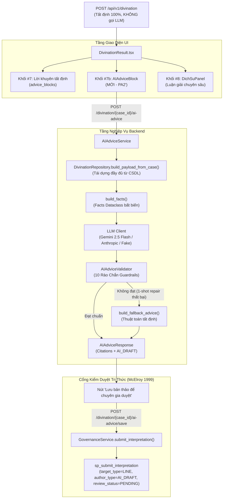

# ADR-007: Kiến Trúc Tầng Lời Khuyên Hành Động AI (AI Advice Layer — PA2' + Gemini + Save Draft)
**Dự án:** KinhDich_KB (KMS301 — Quản Trị Tri Thức · Nhóm 5, Lớp IS1906)  
**Tác giả:** Process Layer Architect & KMS Core Team  
**Ngày lập:** 31/10/2026  
**Trạng thái:** ACCEPTED (Đã phê duyệt và tích hợp hoàn chỉnh)  

---

## 1. Ngữ Cảnh & Vấn Đề Đặt Ra (Context & Problem Statement)

Trong hệ thống Quản trị Tri thức Mai Hoa Dịch Số `KinhDich_KB`:
- **Động cơ suy luận (SynthesisEngine)** tại Tầng 2 vận hành theo nguyên lý **Tất định (Deterministic)**: Điểm số phân cực (`score`), nhãn định hướng (`polarity_label`), phân rã điểm (`decomposition`) và độ phủ tri thức (`coverage`) được tính toán toán học nghiêm ngặt theo 3 trụ cột (Ngũ hành Thể Dụng, Luật chuyên gia AST DSL, Diễn giải bối cảnh).
- **Nhu cầu người dùng cuối**: Cần các chỉ dẫn hành động thực tiễn, súc tích (3–5 gạch đầu dòng), bám sát hào động và biến chuyển Thể Dụng, diễn đạt trang nhã, giàu tính nhân văn và đạo lý Dịch học.
- **Rủi ro của LLM**: Nguy cơ ảo giác (Hallucination), tự ý thay đổi điểm số/nhãn phân cực, tuyệt đối hóa tương lai (vi phạm G6), hoặc rò rỉ mã định danh/prompt nội bộ.
- **Vấn đề bộ nhớ server restart**: `_CASE_STORE` lưu trong RAM có thể mất sau khi service khởi động lại, khiến các truy vấn tiếp nối gặp rủi ro payload rỗng nếu không tái dựng từ database.

---

## 2. Quyết Định Kiến Trúc (Architectural Decisions)

Hệ thống chốt phương án kiến trúc **PA2'** kết hợp nhà cung cấp **Google Gemini** và quy trình lưu bản thảo **Save Draft**:

### 2.1. Tách Biệt Hoàn Toàn Điểm Số & Nhãn Phân Cực (Immutability Guarantee)
- `POST /api/v1/divination` giữ nguyên 100% tất định.
- AI Advice Layer chạy trên endpoint bất đồng bộ riêng: `POST /api/v1/divination/{case_id}/ai-advice`.
- AI tuyệt đối không thể thay đổi `synthesis.score`, `polarity_label`, `coverage`.

### 2.2. Hỗ Trợ Đa Nhà Cung Cấp & Google Gemini Client
- Bổ sung `GeminiClient` tuân thủ protocol `LLMClient`.
- Endpoint: `POST https://generativelanguage.googleapis.com/v1beta/models/{model}:generateContent`.
- Xác thực an toàn: Dùng header `x-goog-api-key`, không đưa khóa bí mật lên query string trên URL.
- Khử khóa tự động (`_sanitize_message`) nhằm loại trừ khả năng rò rỉ API key vào log hệ thống.

### 2.3. Tái Dựng Dữ Kiện Từ CSDL (`build_payload_from_case`)
- Giải quyết triệt để lỗi mất dữ liệu khi restart: Khôi phục cấu trúc quẻ Chủ/Hỗ/Biến (`get_hexagram_taxonomy`), ngũ hành, kinh văn, diễn giải và các luật đã kích hoạt từ `divination_cases.system_output_summary`.
- Dùng chung cho cả endpoint AI Advice và Copilot luận giải chi tiết.

### 2.4. Hậu Kiểm 10 Rào Chắn Nghiêm Ngặt (`AIAdviceValidator`)
1. **Format**: Đúng 3–5 gạch đầu dòng bắt đầu bằng `- `.
2. **Citation Validity**: 100% thẻ căn cứ xuất hiện nằm trong `facts.valid_citations`.
3. **Citation Density**: Mỗi gạch đầu dòng có ≥ 1 thẻ căn cứ hợp lệ.
4. **Forbidden Words**: Tuyệt đối không chứa từ khẳng định chắc chắn (G6).
5. **Label Lock**: Không chứa nhãn mâu thuẫn với `facts.polarity_label` (G1).
6. **Leak Strings**: Không làm lộ `case_id`, hash người dùng, hoặc disclaimer.
7. **Length**: Chiều dài văn bản ≤ 1200 ký tự.
8. **Prompt Injection**: Không làm lộ hướng dẫn hệ thống nội bộ (G8).
9. **Stop Reason**: Không bị ngắt quãng do `max_tokens` hay `safety`.
10. **Safety Note**: Bắt buộc có khuyến nghị tham vấn chuyên gia thực tế nếu chủ đề là `HEALTH` hoặc `FINANCE`.

### 2.5. Cơ Chế Đóng Góp Bản Thảo Chuyên Gia (Save Draft Workflow)
- Kết quả sinh từ AI luôn mang nhãn `AI_DRAFT` và nguồn gốc `AI_AUGMENTED_RAG`.
- Nút "Lưu bản thảo để chuyên gia duyệt" gọi `POST /divination/{case_id}/ai-advice/save`.
- Endpoint ghi nhận diễn giải tri thức mới thông qua Stored Procedure `sp_submit_interpretation` ở trạng thái bắt buộc `review_status = 'PENDING'`.
- Cơ chế `pop()` trong bộ nhớ đệm ngăn chặn triệt để hành vi lưu trùng lặp (Idempotency) và trả mã lỗi `410 GONE` nếu phiên đã hết hạn.
- **AI không bao giờ tự phê duyệt**: Chỉ chuyên gia con người qua thẩm định tại Gate 10 mới có thể chuyển trạng thái sang `APPROVED`.

---

## 3. Hệ Quả & Đánh Giá (Consequences)

### Ưu điểm (Positive):
1. **Toàn vẹn tri thức**: Tầng tính toán sense-making giữ được độ tin cậy toán học tuyệt đối.
2. **Trải nghiệm người dùng vượt trội**: Cung cấp lời khuyên hành động ngắn gọn, trực diện, dễ áp dụng.
3. **Chi phí & hiệu năng tối ưu**: Mặc định hiển thị nút CTA bấm tay (không tự động gọi LLM cho mọi ca gieo); cache TTL 1 giờ.
4. **Độ tin cậy 100%**: Khi LLM gặp sự cố hoặc vi phạm guardrails, bộ sinh tất định `build_fallback_advice()` tự động kích hoạt mượt mà, người dùng không bao giờ gặp lỗi gián đoạn.

### Ràng buộc kỹ thuật (Trade-offs & Constraints):
1. **Phụ thuộc quota mạng**: Cần cấu hình `LLM_MODEL` và `GEMINI_API_KEY` (hoặc `LLM_API_KEY`).
2. **Độ trễ API**: Endpoint async có timeout tối đa 45 giây.
